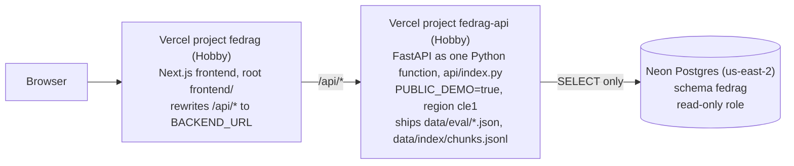

# Deploying FedRAG

This guide puts the public demo online at no cost, as two **Vercel** projects built from the same
GitHub repository: the Next.js frontend, and the FastAPI backend as one Python function. The data
stays in the **Neon** Postgres database the project already uses, read through a read-only role.

Every step that creates an account, sets a password or a secret, or publishes something is yours
to run. Nothing in the repository does any of that for you. Commands are meant to be run from the
repository root unless a step says otherwise.



**The public demo makes no OpenAI calls.** With `PUBLIC_DEMO=true` the backend needs no OpenAI key
and refuses the two features that would call OpenAI:

| Feature | On the public demo |
|---|---|
| Ask the Fed (`POST /api/ask`, `/api/ask/stream`) | `403` with a message to run FedRAG locally (a malformed request still gets its `422` first). The page shows the 8 recorded answers from `GET /api/ask/examples` instead |
| Statement Comparison (`POST /api/compare`) | The sentence diff of any pair, plus the stored analysis where one exists (all 96 consecutive pairs). Asking for a new analysis never calls OpenAI (see [What each tab should show](#what-each-tab-should-show)) |
| Policy Stance, meetings, RAG Performance | Complete: read from Neon, the tracked `data/eval/*.json` files and `data/index/chunks.jsonl` |
| `GET /api/health` | Reports `demo_mode: true`, which the frontend reads to adapt its UI |

## Placeholders

Every value in angle brackets is yours to fill in. None of them belongs in a committed file.

| Placeholder | What it is | Example |
|---|---|---|
| `<NEON_RO_PASSWORD>` | A strong password you generate for the read-only role (step 1) | output of `openssl rand -hex 24` |
| `<NEON_POOLED_HOST>` | Your Neon endpoint's **pooled** host name | `ep-cool-name-a1b2c3d4-pooler.us-east-2.aws.neon.tech` |
| `<NEON_DB>` | The Neon database that holds schema `fedrag` | `neondb` |
| `<GITHUB_USER>` | The GitHub account that holds the repository | `hoedongkim` |
| `<API_DOMAIN>` | The API project's production domain, without `https://` (step 2) | `fedrag-api.vercel.app` |
| `<VERCEL_DOMAIN>` | The frontend project's production domain, without `https://` (step 3) | `fedrag.vercel.app` |

The repository's address, `https://github.com/hoedongkim/fedrag`, is also written into committed
files. If you push the repository under another account or name, change every one of them before
deploying; `grep -rn github.com/hoedongkim backend/app frontend/src deploy/hf-space` lists them:

- `frontend/src/lib/site.ts`: `REPO_URL` (the landing page's **GitHub** button and the footer
  link, and the base of `TECHNICAL_REPORT_URL`, which the links to sections of
  `docs/technical-report.md` use; those also assume the branch is named `main`);
- `frontend/src/lib/site.test.ts`: the expected values that test `REPO_URL` (`make check` fails
  until they match);
- `frontend/src/components/ShareImage.tsx`: the address drawn into the link-preview image;
- `backend/app/ingest/http.py` and `backend/app/stance/fred.py`: the User-Agent of the downloads;
- `deploy/hf-space/README.md`: the link at the top of the Space's page (the
  [alternative host](#the-hugging-face-space-alternative));
- `frontend/src/app/layout.tsx`: the author's GitHub profile in the page metadata (only for
  another account).

## 0. Prerequisites

- **The repository on GitHub**, with your latest commit pushed to `main`: Vercel builds both
  projects from GitHub, never from this machine. The API needs `api/index.py`,
  `requirements.txt`, `.python-version`, `vercel.json`, and `data/index/chunks.jsonl` with
  `manifest.json` in that commit (`git ls-files data/index` lists both).
  [`commit-guide.md`, section 4](commit-guide.md#4-after-the-first-push-the-vercel-packaging)
  lists the files of that commit and the checks to run before pushing it.
- **The data already in Neon**, loaded with your own (read-write) `DATABASE_URL` in `backend/.env`:
  `make db-load` (meetings and documents), `make stance` (stance results and the federal funds
  target range) and `make compare-precompute` (the 96 stored analyses). The demo only reads them.
- **`make check` passes.** It includes `backend/tests/test_vercel.py`, which runs the API's Vercel
  entrypoint and checks `requirements.txt` against what the demo imports.
- **A Vercel account** on the free Hobby plan, signed up with GitHub (step 2).
- **Optional:** `psql` (or the Python one-liner below) to test the read-only role.

## 1. Neon: a read-only role

The public backend only reads schema `fedrag`, so it gets a role that can do nothing else. Create
it with SQL, not in the Console's Roles page: Neon makes roles created there members of
`neon_superuser`, which can do much more.

1. Generate a password. Hex keeps it URL-safe, so it needs no escaping in a connection string:

   ```bash
   openssl rand -hex 24
   ```

2. Open the [Neon Console](https://console.neon.tech) → your project → **SQL Editor**. Pick the
   branch (usually `production` or `main`) and the database `<NEON_DB>` that holds schema `fedrag`.
   The script must run as the role that loaded FedRAG (the user in your own `DATABASE_URL`,
   usually `neondb_owner`): its default privileges then cover tables that role creates later.
3. Paste the whole of [`deploy/neon_readonly.sql`](../deploy/neon_readonly.sql) into the editor.
   **In the editor only**, replace `<choose-a-strong-password>` with the password from step 1.
   Never save the password into the file.
4. Click **Run**. The script creates the role `fedrag_demo_reader` (login, no other privilege, at
   most 10 connections, sessions read-only by default, a 15 s statement timeout), grants it
   `USAGE` on schema `fedrag` and `SELECT` on its tables (now and later), and ends with three
   checks. Expected:
   - the first lists every `fedrag` table (`documents`, `fed_funds_target`, `meetings`,
     `stance_results`, `statement_comparisons`) with `can_select = t` and `can_write = f`;
   - the second shows `can_create_in_fedrag = f`, `can_create_in_public = f`, `settings` with
     `default_transaction_read_only=on`, and an empty `member_of`;
   - the third returns no rows: the role can read no table outside schema `fedrag`.

   The read-only and timeout settings are session defaults the role could change itself; what
   stops writes is that it has no privilege to write, and what keeps strangers out is the
   password, so treat the URL as a secret.

   Running it a second time fails at `CREATE ROLE` because the role exists; the comments at the
   end of the script show how to rotate the password or drop the role.
5. Build the read-only connection string. Take the host and database name from the **Connect**
   dialog (turn **Connection pooling** on, so the host ends in `-pooler`), or from your own
   `DATABASE_URL` in `backend/.env` (open the file in your editor; do not paste it anywhere):

   ```text
   postgresql://fedrag_demo_reader:<NEON_RO_PASSWORD>@<NEON_POOLED_HOST>/<NEON_DB>?sslmode=require
   ```

   The role name must match the one in `deploy/neon_readonly.sql`. If Neon's dialog also shows
   `&channel_binding=require`, you may keep it.

6. Test it from this machine without echoing it or saving it in your shell history:

   ```bash
   read -rs RO_URL      # paste the read-only URL, press Enter (nothing is shown)
   RO_URL="$RO_URL" backend/.venv/bin/python - <<'PY'
   import os, psycopg
   with psycopg.connect(os.environ["RO_URL"], autocommit=True) as conn:
       print("meetings:", conn.execute("SELECT count(*) FROM fedrag.meetings").fetchone()[0])
       # Lift the read-only session default first, so this tests the privileges themselves.
       conn.execute("SET default_transaction_read_only = off")
       try:
           conn.execute("CREATE TABLE fedrag.ro_check (x int)")
           conn.execute("DROP TABLE fedrag.ro_check")
           print("WRONG: the role can create tables")
       except psycopg.errors.InsufficientPrivilege:
           print("ok: read-only")
   PY
   ```

   Expected: `meetings: 97` (or more, after later loads) and `ok: read-only`.

7. Optional, the whole API on the read-only role, in demo mode, on this machine:

   ```bash
   DATABASE_URL="$RO_URL" PUBLIC_DEMO=true make dev
   ```

   Environment variables override `backend/.env`, so this run uses the read-only role and demo
   mode even though your `.env` holds the read-write URL and an OpenAI key. Open
   http://127.0.0.1:3000 and click through the four tabs (see
   [What each tab should show](#what-each-tab-should-show)). Stop with Ctrl-C, then
   `unset RO_URL`.

Keep the read-only URL in your password manager: step 2 needs it once more.

## 2. Vercel: the API project

The backend runs as one Vercel Function with Vercel's FastAPI preset: every request reaches the
FastAPI app with its path unchanged, so `https://<API_DOMAIN>/api/health` is the route
`/api/health`. It is a separate project from the frontend, built from the same repository, with
the repository root as its root directory, because the function needs both `backend/app` and
`data/`.

### 2.1 What the repository sets up

| File | What it does |
|---|---|
| `api/index.py` | The entrypoint Vercel's FastAPI preset finds (it looks for an `app` in `api/index.py`, among other places). It puts `backend/` on the import path and builds the app with `create_app()`. It sets `PUBLIC_DEMO=true` whatever the project's variables say, since the function has no OpenAI client, vector store or model installed, and defaults `ENVIRONMENT` to `production` |
| `requirements.txt` | What Vercel installs (with uv, for Linux): the 11 backend dependencies the demo imports and the 38 packages they pull in, 49 in all, each at the version `backend/constraints.txt` pins. No torch, transformers, Chroma or openai. `backend/pyproject.toml` stays the full app's dependency list; `make setup` never reads this file |
| `.python-version` | `3.13`, the Python the project is developed and tested with (Vercel's default is 3.12) |
| `vercel.json` | The FastAPI preset, the function region `cle1` (Cleveland, next to Neon's `us-east-2`; the Hobby plan runs functions in one region), a 30 s time limit per request, and `excludeFiles`, which keeps `frontend/`, `docs/`, `deploy/`, `scripts/`, `.github/` and the backend's tests and scripts out of the function |
| `data/index/chunks.jsonl`, `manifest.json` | The search index's passages, tracked in git so the function can show them in the RAG Performance drilldown (no vector store is needed) |
| `.vercelignore` | Only matters if someone runs `vercel deploy` (the CLI) from a checkout, which uploads files git ignores: it keeps `backend/.env` (your OpenAI key and read-write `DATABASE_URL`, which the function would read), the vector store and the models out. A push to GitHub holds none of them anyway |

The frontend project ignores all of these: Vercel reads `vercel.json` from a project's root
directory, and the frontend's is `frontend/`.

Measured on this repository with the Vercel CLI's own build (`vercel build`, CLI 64.0.2, which
runs the same Python builder): Python 3.13 from `.python-version`, the packages from
`requirements.txt`, and a function of about 146 MB (134 MB of Linux packages, 12 MB of code and
data), well under the 500 MB a Python function may hold. The largest response,
`GET /api/evaluation`, is 383 KB, under the 4.5 MB limit. Importing the app takes about 0.6 s on a laptop and the process
peaks at about 180 MB of memory (the Hobby plan gives a function 2 GB).

Deploy through GitHub only. To repeat that measurement, run `vercel build` in a copy of the
repository, not in this checkout: the builder writes a `pyproject.toml` and `uv.lock` (converted
from `requirements.txt`) and `.vercel/` into the root. All three are git-ignored, because a
committed `pyproject.toml` would take precedence over `requirements.txt` on Vercel.

### 2.2 Optional: run the function on this machine first

`make vercel-check` builds a clean virtualenv from `requirements.txt` alone (in
`deploy/build/vercel/`, git-ignored), copies the files the next push would hold (what git tracks
or would add under `api/`, `backend/app/` and `data/`; never `backend/.env`), loads `api/index.py`
the way Vercel does and calls every endpoint the frontend uses. Without a database the database
routes must answer `503`; with the read-only URL they must answer `200`. The URL is read from a
file only you can read, so it never appears on the command line or in your shell history:

```bash
make vercel-check                                     # no database
# once: the read-only URL from step 1 in a file outside the repository
read -rs RO_URL                                       # paste the read-only URL
(umask 077; printf 'DATABASE_URL=%s\n' "$RO_URL" > ~/.fedrag-space.env); unset RO_URL
make vercel-check ENV_FILE=~/.fedrag-space.env        # every call against Neon, read-only
```

It ends with `vercel-check: OK`, a table of every call's status and size, the import time and the
peak memory. The check uses this machine's wheels (macOS), not the Linux ones Vercel installs.

### 2.3 Create the project

1. Sign up at [vercel.com/signup](https://vercel.com/signup) with **Continue with GitHub** (the
   free Hobby plan is for personal, non-commercial projects, which a portfolio demo is).
2. **Add New… → Project**, and import `<GITHUB_USER>/fedrag`. Grant the Vercel GitHub app access to
   that repository when asked.
3. On the configure screen:
   - **Project Name**: `fedrag-api`. It becomes the domain `fedrag-api.vercel.app` if that is free.
   - **Framework Preset**: **FastAPI** (detected from `requirements.txt`; `vercel.json` sets it
     too). If Vercel offers to set the repository up as several services (it sees `frontend/` and
     `backend/`), decline: this project is the API only.
   - **Root Directory**: leave it at the repository root (`./`). The function needs `backend/app`
     and `data/`, which a root directory of `backend` would cut off.
   - **Build and Output Settings**: leave every override off. The FastAPI preset installs
     `requirements.txt` and has no build step.
   - **Environment Variables**, for Production and Preview:

     | Name | Value | Notes |
     |---|---|---|
     | `DATABASE_URL` | the read-only URL from step 1 | Mark it **Sensitive** if the form offers it. Never the read-write URL in `backend/.env` |
     | `PUBLIC_DEMO` | `true` | `api/index.py` sets it anyway; the variable keeps the mode visible in the settings |
     | `CORS_ORIGINS` | `["https://<VERCEL_DOMAIN>"]` | Optional, and added after step 3, once the domain exists |

     To paste the URL without showing it, copy it from the file of step 2.2 to the clipboard:
     `sed -n 's/^DATABASE_URL=//p' ~/.fedrag-space.env | tr -d '\n' | pbcopy`, paste it into the
     value field, then clear the clipboard with `pbcopy < /dev/null`.

     Do **not** add `OPENAI_API_KEY`. The demo needs none, and the function has no OpenAI client
     installed. `ENVIRONMENT` defaults to `production` and `RETRIEVER_PRESET` to `tuned`.
4. **Deploy.** The build log shows `Using Python 3.13 from .python-version` and
   `Installing required dependencies from requirements.txt...`, then the build completes, within a
   minute or two. The project's **Domains** list then shows `<API_DOMAIN>`.
5. Test it:

   ```bash
   API=https://<API_DOMAIN>     # no trailing slash
   curl -s "$API/api/health"
   ```

   Expect `"environment":"production"`, `"demo_mode":true`, `"database_configured":true`,
   `"llm_configured":false` and `"vector_store_ready":false` (the demo has no vector store and does
   not need one). The first request after a quiet spell takes a few seconds longer: Vercel starts the
   function (a cold start) and Neon resumes its compute. The full list of checks is in
   [step 4](#4-post-deploy-checklist).

Check two settings once the project exists:

- **Settings → Functions:** the function region reads Cleveland, USA (`cle1`), from `vercel.json`.
  Fluid compute is on by default for new projects; leave it on (one instance then serves many
  requests).
- **Settings → Deployment Protection:** leave **Standard Protection**, the default. It protects
  preview deployments, but not the production domain `<API_DOMAIN>` that the frontend calls. Do
  not extend protection to production: the frontend's requests would get a login page instead of
  the API.

A variable you add or change reaches the function with the next deployment: **Deployments → ⋯ →
Redeploy**.

## 3. Vercel: the frontend project

1. **Add New… → Project**, and import the same repository, `<GITHUB_USER>/fedrag`, again.
2. On the configure screen:
   - **Project Name**: e.g. `fedrag`; it becomes the domain `<project-name>.vercel.app` if that is
     free;
   - **Root Directory**: **Edit** → `frontend`;
   - **Framework Preset**: Next.js (detected once the root directory is `frontend`);
   - Build, output and install settings: leave the defaults (`next build`, `npm install`);
   - **Environment Variables**: `BACKEND_URL` = `https://<API_DOMAIN>` (no trailing slash, no
     `/api`), for Production and Preview. Previews use the API's production domain too: the API
     project's own preview URLs are behind Deployment Protection.
3. **Deploy.** When it finishes, the project's **Domains** list shows `<VERCEL_DOMAIN>`.
4. Optional: **Settings → Build and Deployment → Node.js Version** to `24.x`, the version CI uses.
   Redeploy afterwards.

The frontend needs no `vercel.json`: the root directory is a project setting, and the `/api` proxy
is the rewrite in `frontend/next.config.ts`.

`BACKEND_URL` is the only variable the frontend needs. Two more are optional (both documented in
`frontend/.env.example`, both read at build time):

| Variable | Default | Set it when |
|---|---|---|
| `SITE_URL` | Vercel's production domain (`VERCEL_PROJECT_PRODUCTION_URL`, set by Vercel) | You add a custom domain and want link previews (Open Graph) to use it, e.g. `https://<your-domain>` |
| `BACKEND_MAY_SLEEP` | `true` for any `BACKEND_URL` that is not on this machine | Leave it unset. With `true`, an API that has not answered after 2.5 s (a cold start) is shown as waking ("Waking the demo server"), and requests that fail the way a starting server fails are sent again for up to about two and a half minutes, instead of showing an error at once |

**`BACKEND_URL` is read at build time** by that rewrite (and at request time by server code). After
changing it, redeploy: **Deployments → ⋯ → Redeploy**. Every push to `main` deploys both projects
to production automatically; other branches and pull requests get preview deployments, which call
the API's production domain.

Now finish the loop on the API project: set its `CORS_ORIGINS` variable to
`["https://<VERCEL_DOMAIN>"]` and redeploy it. The browser never calls the API directly: it calls
`https://<VERCEL_DOMAIN>/api/...`, and Vercel forwards the request server to server, so CORS plays
no part in the demo. The list keeps other sites' pages from calling the API from a browser. The
default allows only `localhost:3000` and `127.0.0.1:3000`.

**Optional: skip builds a push does not need.** Each push to `main` builds both projects, one after
the other on the Hobby plan. In each project, **Settings → Build and Deployment → Ignored Build
Step** (choose **Custom**) can run a command; exit code 0 skips the build, and any other code
builds. The command runs in the project's root directory:

| Project | Command |
|---|---|
| API | `git diff --quiet "$VERCEL_GIT_PREVIOUS_SHA" HEAD -- api backend/app data requirements.txt .python-version vercel.json .vercelignore` |
| Frontend | `git diff --quiet "$VERCEL_GIT_PREVIOUS_SHA" HEAD -- .` |

`VERCEL_GIT_PREVIOUS_SHA` is the commit of the project's last successful deployment on that
branch, so the command compares everything pushed since then, however many commits a push holds
(`HEAD^ HEAD` would look at the last commit only, and skip an API change that an earlier commit of
the same push made). On a branch's first deployment the variable is empty, and when that commit is
deeper than the 10 commits Vercel clones git cannot find it; either way git exits with an error
code and the project builds.

A redeploy you start by hand (such as after changing a variable) can be skipped by the command as
well, since no file changed: untick **Use project's Ignore Build Step** in the **Redeploy** dialog
to build it anyway.

## 4. Post-deploy checklist

### API checks

Run these against the API project directly, then again through the frontend, to test the proxy
too:

```bash
API=https://<API_DOMAIN>
WEB=https://<VERCEL_DOMAIN>
for BASE in "$API" "$WEB"; do
  echo "== $BASE"
  curl -s "$BASE/api/health"; echo
  curl -s "$BASE/api/meetings" | jq length                                  # 97
  curl -s "$BASE/api/stance?classifier=llm_zero_shot" | jq '.points | length'   # 97
  curl -s "$BASE/api/stance/benchmark" | jq '.statement_level | length'        # 6
  curl -s -X POST "$BASE/api/compare" -H 'Content-Type: application/json' \
       -d '{"base_date": "2024-07-31", "target_date": "2024-09-18"}' | jq -c '{stats, analysis_status}'
                                                                            # analysis_status "ready"
  curl -s "$BASE/api/evaluation" | jq -c '.selection | {config, method, metric}'  # tuned, hybrid_rerank
  curl -s "$BASE/api/evaluation/questions/sf-05" | jq -c '{id, passages_available}'   # true
  curl -s "$BASE/api/ask/examples" | jq length                              # 8
  curl -s -o /dev/null -w 'ask: %{http_code}\n' -X POST "$BASE/api/ask" \
       -H 'Content-Type: application/json' -d '{"question": "What did the FOMC decide in September 2024?"}'
                                                                            # ask: 403
done
```

Two more that must hold on the demo:

```bash
# A malformed question is still rejected as invalid first: 422, not 403.
curl -s -o /dev/null -w '%{http_code}\n' -X POST "$API/api/ask" -H 'Content-Type: application/json' -d '{}'

# A new analysis is never generated: a non-consecutive pair has none stored.
curl -s -X POST "$API/api/compare" -H 'Content-Type: application/json' \
     -d '{"base_date": "2015-01-28", "target_date": "2024-09-18", "analysis": "generate"}' \
     | jq -c '{analysis_status, analysis}'
# {"analysis_status":"disabled_on_demo","analysis":null}
```

The API project's **Logs** tab shows each request and any error the function raised.

### What each tab should show

- **Header, on every page:** the links Overview, Ask the Fed, Policy Stance, Compare and
  Performance (on a phone, Overview is left out and the FedRAG wordmark leads home), and at the
  right a green dot with the word **Demo**, never **Setup needed** (its tooltip says live questions
  and new analyses are off). If the API meets a cold start and takes more than 2.5 s to answer, it
  reads **Waking** first, with an amber dot, and one line above the page says the demo server is
  waking (usually a few seconds); the pages load once it answers.
- **Overview (`/`):** the landing page, with one quiet line under the **Try it** and **GitHub**
  buttons saying the demo makes no paid API calls, so Ask the Fed shows recorded answers, and a
  plain row per tab whose headline number is read from the API, not typed into the page: answer
  faithfulness 0.94 (Ask the Fed), accuracy 0.84 on the human labels (Policy Stance), the stored
  reading of the July to September 2024 statements, "More dovish" (Statement Comparison), and
  nDCG@10 0.58 against 0.36 (RAG Performance).
- **Ask the Fed (`/ask`):** one quiet line saying live questions are off, with a **Run it locally**
  link to the technical report's **Run it yourself** section; the **Recorded questions** list of
  eight (Statement fact, Minutes quantifier, Point in time, Two meetings, Paraphrase, Declines, Vote
  and terms, Staff outlook), a dropdown instead below 1024 px; the selected answer with its citation markers and its
  numbered **Sources** (a source whose excerpt is shorter than its passage has **Show full
  passage**, and following a marker opens it), a metadata line with **Recorded**, **Model** and
  **Search** (`Hybrid + rerank (tuned)`), and the judge's verdict. There is no question form on
  the demo. `/ask?example=pit-04` opens one answer directly.
- **Policy Stance (`/stance`):** the chart of all 97 statements (LLM few-shot by default; the other
  three classifiers switch on under **Show methods**), the reference labels and the federal funds
  target range; the **Selected statement** section (without the "Ask about this meeting" link,
  which the demo does not offer); the benchmark tables under **How the methods compare**.
- **Statement Comparison (`/compare`):** the diff for any two statements; for consecutive pairs the
  stored analysis (July to September 2024: "More dovish"). A pair without one (e.g. 2015-01-28
  against 2024-09-18) shows the diff and "On the public demo, analyses exist only for back-to-back
  meetings. The sentence comparison below is complete without one.", with a **Compare with the
  previous meeting (Jul 31, 2024)** button that loads the consecutive pair, and no **Generate
  analysis** button or "Ask about this change" link.
- **RAG Performance (`/performance`):** the headline numbers and every section (**Search**, **By
  question type**, **Answers**, **Speed and cost**), the judge check inside the closed **About
  these numbers** block, and **Every question**, whose drilldown (e.g. `/performance?q=sf-05`)
  shows the gold passages' text (from `data/index/chunks.jsonl`, which the function ships).

When everything works, put the live link in the README: replace the placeholder line under the
screenshot (marked `OWNER`) with the live-demo line it gives, point the screenshot's link at
`https://<VERCEL_DOMAIN>/ask`, and commit it.

### Rolling back

- **Either project:** Vercel → the project → **Deployments** → the last good production deployment
  → **⋯ → Instant Rollback** (the Hobby plan rolls back to the previous production deployment).
  Production then serves it until the next push to `main`. For an older state, revert the commit on
  `main` and push: both projects rebuild from it.
- **Cut the API off from the data at once:** rotate the read-only role's password in the Neon SQL
  editor (`ALTER ROLE fedrag_demo_reader WITH PASSWORD '...';`). The API then answers `503` for
  meetings, stance and comparisons, and the rest of the demo keeps working. Put the new URL in the
  API project's `DATABASE_URL` and redeploy to bring them back.
- **Database:** the API cannot change Neon. To undo a bad data load you ran yourself, use Neon's
  point-in-time restore (the history window depends on your plan).
- **Credentials:** if the read-only URL leaks, rotate the password as above, then update
  `DATABASE_URL` in the API project and redeploy.

### Updating data and results later

After a new FOMC meeting, run the pipeline on your machine with the read-write `DATABASE_URL` and
your OpenAI key in `backend/.env`:

```bash
make ingest && make db-load              # new statement and minutes into Neon
make index                               # new chunks: a few cents at most
make stance                              # classify the new statement (cached for the old ones)
make compare-precompute                  # analyse the new consecutive pair (about $0.006)
make compare-evaluate                    # refresh data/eval/compare_benchmark.json
```

The API reads Neon live, so meetings, stance and stored analyses update without a redeploy. Then
commit the changed tracked files (`data/eval/*.json`, and `data/index/chunks.jsonl` with
`manifest.json`, so the drilldown passages match) and push: the API project redeploys with them.
The RAG benchmark is a fixed snapshot of the October 2026 run: new documents do not change it, and
the chunk ids it refers to stay valid for documents that did not change.

### Costs and limits

| Service | Plan | Cost |
|---|---|---|
| Vercel | Hobby, two projects | $0 |
| Neon | Free plan (the project already runs on it) | $0 |
| OpenAI | No key on Vercel; demo mode refuses every OpenAI path | $0 |

The Hobby plan's function limits, against what the API uses:

| Limit (Hobby) | The API |
|---|---|
| 500 MB per Python function | about 146 MB |
| 4.5 MB per request or response body | 383 KB at most (`GET /api/evaluation`) |
| 2 GB of memory, 1 vCPU | about 180 MB at peak (measured locally) |
| 300 s per request at most | 30 s, set in `vercel.json`; requests take well under a second once warm |
| One function region | `cle1`, next to the Neon database |

Usage counts against the Hobby plan's monthly allowance; the project's **Usage** tab shows it.

### Cold starts

- **Vercel:** functions do not sleep and there is nothing to wake before sharing the link. With
  Fluid compute, one instance serves many requests and stays up while traffic comes in. After a
  quiet spell the next request starts a new instance, a cold start of a few seconds: the Python
  runtime starts and the app is imported (about 0.6 s on a laptop; Vercel's single vCPU is
  slower). If `/api/health` takes more than 2.5 s, the header reads **Waking** until it answers.
- **Neon:** the free plan's compute is suspended after a few minutes without queries and resumes
  on the next one, which adds a short delay to the first database request (2.1 s for the first
  `GET /api/meetings` in the local check, against 0.06 s for the next).

## 5. Running the full app with OpenAI locally

The demo is the read-only face of the project; the full app runs on your machine.

```bash
make setup                                  # once
cp backend/.env.example backend/.env        # once; then edit backend/.env:
#   OPENAI_API_KEY=<your key>
#   DATABASE_URL=<your read-write Neon URL, or the one make db-up prints>
#   leave PUBLIC_DEMO unset (or false)
make index                                  # once, builds data/chroma (about $0.02)
make dev                                    # http://127.0.0.1:3000
```

`/api/health` then reports `demo_mode: false`, `llm_configured: true` and
`vector_store_ready: true`. Ask the Fed streams new answers (about $0.003 each), and Statement
Comparison's **Generate analysis** writes and stores a new analysis for a pair (about $0.006).
`PUBLIC_DEMO=true make dev` shows the demo experience on the same machine, with no OpenAI call.

From a fresh clone without a Neon database, the technical report's
[Run it yourself](technical-report.md#-run-it-yourself) section builds everything locally, with or
without an OpenAI key.

## The Hugging Face Space alternative

The repository still packages the API as a Docker Space for Hugging Face: `deploy/hf-space/` (the
Dockerfile and the Space's README) and `make space-bundle` (`scripts/build_hf_space.sh`), which
assembles the Space's files in `deploy/build/hf-space/` and checks them for secrets. Hugging Face
now requires a PRO subscription to create a Docker Space (creating one on a free account fails
with HTTP 402), so the public demo uses Vercel instead. With PRO, the Space works as before: the
steps are in [`deploy/README.md`](../deploy/README.md#alternative-a-hugging-face-space). It reads
the same read-only role (step 1), and the frontend project then uses
`BACKEND_URL=https://<HF_USER>-<SPACE_NAME>.hf.space` (your Hugging Face user name and the Space's
name) instead of the API project. A Space on free hardware sleeps after 48 hours without visitors
and takes a minute or two to wake; the frontend waits for it ("Waking the demo server").

## Troubleshooting

| Symptom | Likely cause and fix |
|---|---|
| The API's build stops at `No FastAPI entrypoint found`, or `Found app/main.py but it does not define a top-level "app"` | The Root Directory is not the repository root (with `backend`, Vercel would also install the full `backend/pyproject.toml`), or the Framework Preset is not FastAPI. Both are in the API project's **Settings → Build and Deployment**. If both are right, the builder no longer looks in `api/` (its source and Vercel's guide "Ship a FastAPI app" list the folder; the FastAPI framework page names only the root, `src/` and `app/`): move the entrypoint to `index.py` at the root (its `BACKEND_DIR` is then `parents[0] / "backend"`) and update the paths that name it (`git grep -n api/index.py` lists them; the Makefile and CI also lint `../api`) |
| The API's build log says `Installing required dependencies from pyproject.toml` | A `pyproject.toml` (or `Pipfile`, `uv.lock`) at the root or in `api/` was pushed, for example the one `vercel build` writes, and Vercel installs it instead of `requirements.txt`. Remove it from git; `make check` fails while one is there |
| The API's build fails while installing dependencies | `requirements.txt` and PyPI disagree, or a pin was edited by hand. `make check` (`backend/tests/test_vercel.py`) and `make vercel-check` reproduce the install and the imports |
| A request returns `500` with `FUNCTION_INVOCATION_FAILED` | The function failed to start. The API project's **Logs** show the traceback; a missing package is the usual cause, and `make vercel-check` shows it locally |
| `/api/health` says `database_configured: false`; meetings, stance and comparisons answer `503` with `Database not configured: set DATABASE_URL in backend/.env.`, and the pages say "Database not configured" | `DATABASE_URL` is missing, misnamed or set for another environment in the API project (the message is worded for running FedRAG locally; the function has no `backend/.env`). Add it to the API project's variables, then redeploy |
| `/api/meetings` answers `503` | Neon rejected the connection: wrong host, database or password. Test the URL as in step 1.6 |
| `permission denied for table ...` in the API's logs | A table was created after the grants. Rerun the `GRANT SELECT ON ALL TABLES` line of `deploy/neon_readonly.sql` |
| `/api/evaluation/questions/sf-05` reports `passages_available: false` | `data/index/chunks.jsonl` or `manifest.json` is not in the pushed commit: `git ls-files data/index` must list both |
| Pages load but say the demo server is not responding | `BACKEND_URL` is wrong, or the frontend was not redeployed after it changed. Open `https://<API_DOMAIN>/api/health` directly |
| The frontend gets a Vercel login page or `401` from the API | `BACKEND_URL` points at a protected deployment URL instead of the API's production domain `<API_DOMAIN>` |
| Ask the Fed answers `503` instead of `403` | The frontend is not calling this API (`api/index.py` always sets `PUBLIC_DEMO=true`): check `BACKEND_URL` |
| The API's logs show a validation error for `cors_origins` | `CORS_ORIGINS` starts with `[` but is not valid JSON: use a JSON list such as `["https://<VERCEL_DOMAIN>"]` (one origin, or origins separated by commas, also work). Fix the variable and redeploy |
| A browser console CORS error | Something calls the API directly instead of through `/api` on the frontend. Add that origin to `CORS_ORIGINS` only if it is yours |
