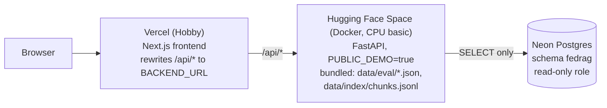

# Deploying FedRAG

This guide puts the public demo online at no cost: the Next.js frontend on **Vercel**, the FastAPI
backend on **Hugging Face Spaces** (Docker), and the data in the **Neon** Postgres database the
project already uses, read through a read-only role.

Every step that creates an account, sets a password or a secret, or publishes something is yours
to run. Nothing in the repository does any of that for you. Commands are meant to be run from the
repository root unless a step says otherwise.



**The public demo makes no OpenAI calls.** With `PUBLIC_DEMO=true` the backend needs no OpenAI key
and refuses the two features that would call OpenAI:

| Feature | On the public demo |
|---|---|
| Ask the Fed (`POST /api/ask`, `/api/ask/stream`) | `403` with a message to run FedRAG locally (a malformed request still gets its `422` first). The page shows the 8 recorded answers from `GET /api/ask/examples` instead |
| Statement Comparison (`POST /api/compare`) | The sentence diff of any pair, plus the stored analysis where one exists (all 96 consecutive pairs). Asking for a new analysis never calls OpenAI (see [What each tab should show](#what-each-tab-should-show)) |
| Policy Stance, meetings, RAG Performance | Complete: read from Neon, the tracked `data/eval/*.json` files and `data/index/chunks.jsonl` |
| `GET /api/health` | Reports `demo_mode: true`, which the frontend reads to adapt its UI |

## Placeholders

Every value in angle brackets is yours to fill in. None of them belongs in a committed file.

| Placeholder | What it is | Example |
|---|---|---|
| `<NEON_RO_PASSWORD>` | A strong password you generate for the read-only role (step 1) | output of `openssl rand -hex 24` |
| `<NEON_POOLED_HOST>` | Your Neon endpoint's **pooled** host name | `ep-cool-name-a1b2c3d4-pooler.us-east-2.aws.neon.tech` |
| `<NEON_DB>` | The Neon database that holds schema `fedrag` | `neondb` |
| `<HF_USER>` | Your Hugging Face user name | `hoedongkim` |
| `<SPACE_NAME>` | The Space's name | `fedrag` |
| `<SPACE_HOST>` | The Space's app URL, `https://<HF_USER>-<SPACE_NAME>.hf.space` (lower case; `_` and `.` become `-`) | `https://hoedongkim-fedrag.hf.space` |
| `<VERCEL_DOMAIN>` | The Vercel production domain, without `https://` | `fedrag.vercel.app` |
| `<GITHUB_USER>` | The GitHub account that holds the repository | `hoedongkim` |
| `<good-commit>` | A commit of this repository to roll the Space back to (only in [Rolling back](#rolling-back)) | `a1b2c3d` |

The repository's address, `https://github.com/hoedongkim/fedrag`, is also written into committed
files. If you push the repository under another account or name, change every one of them before
deploying; `grep -rn github.com/hoedongkim backend/app frontend/src deploy/hf-space` lists them:

- `frontend/src/lib/site.ts`: `REPO_URL` (the landing page's **GitHub** button and the footer
  link, and the base of `TECHNICAL_REPORT_URL`, which the links to sections of
  `docs/technical-report.md` use; those also assume the branch is named `main`);
- `frontend/src/lib/site.test.ts`: the expected values that test `REPO_URL` (`make check` fails
  until they match);
- `frontend/src/components/ShareImage.tsx`: the address drawn into the link-preview image;
- `backend/app/ingest/http.py` and `backend/app/stance/fred.py`: the User-Agent of the downloads;
- `deploy/hf-space/README.md`: the link at the top of the Space's page;
- `frontend/src/app/layout.tsx`: the author's GitHub profile in the page metadata (only for
  another account).

## 0. Prerequisites

- **The repository on GitHub.** Vercel deploys from it. See [`commit-guide.md`](commit-guide.md)
  for the first commits and the pre-push checks.
- **The data already in Neon**, loaded with your own (read-write) `DATABASE_URL` in `backend/.env`:
  `make db-load` (meetings and documents), `make stance` (stance results and the federal funds
  target range) and `make compare-precompute` (the 96 stored analyses). The demo only reads them.
- **The search index files on this machine**: `data/index/chunks.jsonl` and
  `data/index/manifest.json` from `make index`. The bundle copies them so the RAG Performance
  drilldown can show passage text; `data/chroma/` is not needed and not copied.
- **`make check` passes.**
- **The Hugging Face CLI.** `make setup` already installed `hf` into `backend/.venv/bin/hf` (it
  comes with `huggingface_hub`). Do not run `hf update` there: it would replace the version pinned
  in `backend/constraints.txt`. For a newer CLI, install it outside the project, e.g.
  `pipx install huggingface_hub`.
- **Optional:** Docker Desktop, to test the Space image on this machine before uploading it, and
  `psql` (or the Python one-liner below) to test the read-only role.

## 1. Neon: a read-only role

The public backend only reads schema `fedrag`, so it gets a role that can do nothing else. Create
it with SQL, not in the Console's Roles page: Neon makes roles created there members of
`neon_superuser`, which can do much more.

1. Generate a password. Hex keeps it URL-safe, so it needs no escaping in a connection string:

   ```bash
   openssl rand -hex 24
   ```

2. Open the [Neon Console](https://console.neon.tech) → your project → **SQL Editor**. Pick the
   branch (usually `production` or `main`) and the database `<NEON_DB>` that holds schema `fedrag`.
   The script must run as the role that loaded FedRAG (the user in your own `DATABASE_URL`,
   usually `neondb_owner`): its default privileges then cover tables that role creates later.
3. Paste the whole of [`deploy/neon_readonly.sql`](../deploy/neon_readonly.sql) into the editor.
   **In the editor only**, replace `<choose-a-strong-password>` with the password from step 1.
   Never save the password into the file.
4. Click **Run**. The script creates the role `fedrag_demo_reader` (login, no other privilege, at
   most 10 connections, sessions read-only by default, a 15 s statement timeout), grants it
   `USAGE` on schema `fedrag` and `SELECT` on its tables (now and later), and ends with three
   checks. Expected:
   - the first lists every `fedrag` table (`documents`, `fed_funds_target`, `meetings`,
     `stance_results`, `statement_comparisons`) with `can_select = t` and `can_write = f`;
   - the second shows `can_create_in_fedrag = f`, `can_create_in_public = f`, `settings` with
     `default_transaction_read_only=on`, and an empty `member_of`;
   - the third returns no rows: the role can read no table outside schema `fedrag`.

   The read-only and timeout settings are session defaults the role could change itself; what
   stops writes is that it has no privilege to write, and what keeps strangers out is the
   password, so treat the URL as a secret.

   Running it a second time fails at `CREATE ROLE` because the role exists; the comments at the
   end of the script show how to rotate the password or drop the role.
5. Build the read-only connection string. Take the host and database name from the **Connect**
   dialog (turn **Connection pooling** on, so the host ends in `-pooler`), or from your own
   `DATABASE_URL` in `backend/.env` (open the file in your editor; do not paste it anywhere):

   ```text
   postgresql://fedrag_demo_reader:<NEON_RO_PASSWORD>@<NEON_POOLED_HOST>/<NEON_DB>?sslmode=require
   ```

   The role name must match the one in `deploy/neon_readonly.sql`. If Neon's dialog also shows
   `&channel_binding=require`, you may keep it.

6. Test it from this machine without echoing it or saving it in your shell history:

   ```bash
   read -rs RO_URL      # paste the read-only URL, press Enter (nothing is shown)
   RO_URL="$RO_URL" backend/.venv/bin/python - <<'PY'
   import os, psycopg
   with psycopg.connect(os.environ["RO_URL"], autocommit=True) as conn:
       print("meetings:", conn.execute("SELECT count(*) FROM fedrag.meetings").fetchone()[0])
       # Lift the read-only session default first, so this tests the privileges themselves.
       conn.execute("SET default_transaction_read_only = off")
       try:
           conn.execute("CREATE TABLE fedrag.ro_check (x int)")
           conn.execute("DROP TABLE fedrag.ro_check")
           print("WRONG: the role can create tables")
       except psycopg.errors.InsufficientPrivilege:
           print("ok: read-only")
   PY
   ```

   Expected: `meetings: 97` (or more, after later loads) and `ok: read-only`.

7. Optional, the whole API on the read-only role, in demo mode, on this machine:

   ```bash
   DATABASE_URL="$RO_URL" PUBLIC_DEMO=true make dev
   ```

   Environment variables override `backend/.env`, so this run uses the read-only role and demo
   mode even though your `.env` holds the read-write URL and an OpenAI key. Open
   http://127.0.0.1:3000 and click through the four tabs (see
   [What each tab should show](#what-each-tab-should-show)). Stop with Ctrl-C, then
   `unset RO_URL`.

Keep the read-only URL in your password manager: step 2 needs it once more.

## 2. Hugging Face: the backend Space

### 2.1 Account, token and Space

1. Create an account at [huggingface.co/join](https://huggingface.co/join) and confirm your email.
2. Create an access token: **Settings → Access Tokens → Create new token**, type **Write** (or a
   fine-grained token with write access to your Spaces). Keep it in your password manager.
3. Create the Space at [huggingface.co/new-space](https://huggingface.co/new-space):
   - Owner `<HF_USER>`, Space name `<SPACE_NAME>`, licence `mit`;
   - SDK **Docker**, template **Blank**;
   - Hardware **CPU basic · 2 vCPU · 16 GB · FREE**;
   - Visibility **Public**.

   The Space page is `https://huggingface.co/spaces/<HF_USER>/<SPACE_NAME>`; the app itself is
   served at `<SPACE_HOST>`. To see the exact host, open the Space's **⋮** menu → **Embed this
   Space** → **Direct URL**.

   The CLI can do the same, after `backend/.venv/bin/hf auth login` (2.3):
   `backend/.venv/bin/hf repos create <HF_USER>/<SPACE_NAME> --repo-type space --space-sdk docker --public`.

### 2.2 Secrets and variables

In the Space: **Settings → Variables and secrets**. Both kinds reach the container as environment
variables; secrets are hidden from everyone, variables are visible to visitors of the Space's
settings, so only `DATABASE_URL` needs to be a secret.

| Kind | Name | Value | Notes |
|---|---|---|---|
| Secret | `DATABASE_URL` | the read-only URL from step 1 | Never the read-write URL |
| Variable | `PUBLIC_DEMO` | `true` | The image defaults to `true` too; setting it makes the mode visible in the settings |
| Variable | `CORS_ORIGINS` | `["https://<VERCEL_DOMAIN>"]` | A JSON list; one origin, or several separated by commas, works too. Fill it in after step 3, once the domain exists (see below) |
| Variable | `RETRIEVER_PRESET` | `tuned` | Optional; `tuned` is the default |

Do **not** add `OPENAI_API_KEY` to the Space. The demo needs none, and without it no code path can
spend money even if `PUBLIC_DEMO` were switched off by mistake (Ask the Fed would then answer
`503`, and Statement Comparison `llm_not_configured`).

**About `CORS_ORIGINS`.** The browser never calls the Space directly: it calls
`https://<VERCEL_DOMAIN>/api/...`, and Vercel forwards the request server to server, so CORS plays
no part in the demo. Setting the list to your Vercel domain keeps the Space from accepting
cross-origin browser calls from anywhere else, and lets you call the Space from the Vercel origin
directly if you ever need to. The default list allows only `localhost:3000` and `127.0.0.1:3000`.

The same from the CLI (the secret is read from an environment variable, so it never appears in
your shell history):

```bash
backend/.venv/bin/hf auth login                  # once; see 2.3
read -rs DATABASE_URL && export DATABASE_URL     # paste the read-only URL
backend/.venv/bin/hf spaces secrets add <HF_USER>/<SPACE_NAME> -s DATABASE_URL
unset DATABASE_URL
backend/.venv/bin/hf spaces variables add <HF_USER>/<SPACE_NAME> \
  -e PUBLIC_DEMO=true -e RETRIEVER_PRESET=tuned
```

`CORS_ORIGINS` is set at the end of step 3, when the Vercel domain exists.

Changing a secret or variable restarts the Space.

### 2.3 Build the bundle and upload it

The Space runs from its own git repository, which holds only what the container needs.
`make space-bundle` assembles that folder in `deploy/build/hf-space/` (git-ignored) from the repository:

```bash
make space-bundle
```

`scripts/build_hf_space.sh` replaces the folder on every run. It holds the `Dockerfile`,
`.dockerignore` and Space `README.md` from `deploy/hf-space/`, the `LICENSE`, `backend/app/`,
`backend/constraints.txt`, a `backend/requirements.txt` generated from `backend/pyproject.toml`,
the tracked results (`data/eval/*.json` and `stance_gold.jsonl`, including the recorded answers in
`ask_examples.json`), and `data/index/chunks.jsonl` with `manifest.json`: about 12 MB in 107
files, all text, the largest `chunks.jsonl` at 6.9 MB. It never holds `data/chroma/`,
`data/models/`, `data/eval_cache/`, `data/raw/`, `data/processed/` or a `.env` file. Before it
finishes, the script refuses the folder if any file holds an OpenAI-style key, a Neon-style
password, a Postgres URL with a password, or the `OPENAI_API_KEY` or `DATABASE_URL` value in your
`backend/.env` (compared in memory, never printed).
The FOMC text in `chunks.jsonl` is a work of the US government; no Trillion Dollar Words sentence
and no model weight is included.

Check the folder before it leaves your machine:

```bash
ls -la deploy/build/hf-space
du -sh deploy/build/hf-space                                     # about 12 MB
find deploy/build/hf-space \( -name '.env*' -o -name 'chroma*' -o -name '*.sqlite3' \) -print   # prints nothing
grep -rlIE 'sk-(proj-)?[A-Za-z0-9_-]{20,}|npg_[A-Za-z0-9]{8,}' deploy/build/hf-space || echo "no keys found"
```

Open `deploy/build/hf-space/README.md` and check the YAML header at the top: `sdk: docker` and
`app_port: 7860`. The `title` (FedRAG API), `emoji`, `colorFrom`, `colorTo` and
`short_description` are yours to change in `deploy/hf-space/README.md`; rebuild the bundle
afterwards. The image defaults to `PUBLIC_DEMO=true`, `ENVIRONMENT=production` and port 7860, and
runs as the non-root user 1000 that Spaces expect.

**Optional: test the image locally** (needs Docker Desktop). Put the read-only URL in a file
outside the repository, so it is neither committed nor in your history:

```bash
read -rs RO_URL                                      # paste the read-only URL
(umask 077; printf 'DATABASE_URL=%s\n' "$RO_URL" > ~/.fedrag-space.env); unset RO_URL
docker build -t fedrag-space deploy/build/hf-space            # several minutes the first time
docker run --rm -p 127.0.0.1:7860:7860 --env-file ~/.fedrag-space.env fedrag-space
# in another terminal:
curl -s http://127.0.0.1:7860/api/health
```

`-p 127.0.0.1:7860:7860` keeps the container reachable from this machine only. The checks in
[step 4](#4-post-deploy-checklist) work against it too, with `SPACE=http://127.0.0.1:7860`.

Stop the container with Ctrl-C. Delete `~/.fedrag-space.env` when you are done with it.

**Upload.** Log in once with the write token, then upload the folder as one commit to the Space:

```bash
backend/.venv/bin/hf auth login          # log in in the browser, or paste the write token
backend/.venv/bin/hf auth whoami         # shows <HF_USER>
backend/.venv/bin/hf upload <HF_USER>/<SPACE_NAME> deploy/build/hf-space . \
  --repo-type space --commit-message "Deploy FedRAG public demo"
```

The bundle's `README.md` replaces the one the Space was created with. The token is stored in your
Hugging Face cache (`~/.cache/huggingface/token`), outside the repository;
`backend/.venv/bin/hf auth logout` removes it.

**Alternative: git push to the Space repository.** The Space is a git repository. Pushing needs your
user name and the write token as the password (Hugging Face does not accept account passwords for
git):

```bash
git clone https://huggingface.co/spaces/<HF_USER>/<SPACE_NAME> ../<SPACE_NAME>-space
rsync -a --delete --exclude .git deploy/build/hf-space/ ../<SPACE_NAME>-space/
cd ../<SPACE_NAME>-space
git add -A && git commit -m "Deploy FedRAG public demo" && git push
```

Hugging Face rejects files over 10 MB, and binary files, in a plain git push unless they go through
its large-file storage. The bundle has neither today (`chunks.jsonl` is about 7 MB of text), but
`hf upload` handles both automatically, so prefer it. Run this clone outside the FedRAG repository,
as shown, so it is never committed into it.

### 2.4 Watch the build and test the Space

The upload starts a Docker build. Follow it on the Space page (**Logs → Build**, then **Container**)
or from the terminal:

```bash
backend/.venv/bin/hf spaces logs <HF_USER>/<SPACE_NAME> --build -f   # the image build
backend/.venv/bin/hf spaces wait <HF_USER>/<SPACE_NAME> --timeout 20m  # exits 0 once RUNNING
backend/.venv/bin/hf spaces logs <HF_USER>/<SPACE_NAME> -n 50          # the app's log
```

The first build installs CPU-only PyTorch and the pinned dependencies, so expect several minutes.
The container log should end with Uvicorn listening on `0.0.0.0:7860`. Then:

```bash
SPACE=<SPACE_HOST>      # e.g. https://hoedongkim-fedrag.hf.space, no trailing slash
curl -s "$SPACE/api/health"
```

Expect `"environment":"production"`, `"demo_mode":true`, `"database_configured":true`,
`"llm_configured":false` and `"vector_store_ready":false` (the Space has no vector store and does
not need one; in demo mode the header's status reads **Demo**, never **Setup needed**). The full
list of checks is in [step 4](#4-post-deploy-checklist).

## 3. Vercel: the frontend

1. Sign up at [vercel.com/signup](https://vercel.com/signup) with **Continue with GitHub** (the
   free Hobby plan is for personal, non-commercial projects, which a portfolio demo is).
2. **Add New… → Project**, and import `<GITHUB_USER>/fedrag`. Grant the Vercel GitHub app access to
   that repository when asked.
3. On the configure screen:
   - **Project Name**: it becomes the domain `<project-name>.vercel.app` if that is free;
   - **Framework Preset**: Next.js (detected);
   - **Root Directory**: **Edit** → `frontend`;
   - Build, output and install settings: leave the defaults (`next build`, `npm install`);
   - **Environment Variables**: `BACKEND_URL` = `<SPACE_HOST>` (no trailing slash, no `/api`),
     for all environments.
4. **Deploy.** When it finishes, the project's **Domains** list shows `<VERCEL_DOMAIN>`.
5. Optional: **Settings → Build and Deployment → Node.js Version** to `24.x`, the version CI uses.
   Redeploy afterwards.

No `vercel.json` is needed: the root directory is a project setting, and the `/api` proxy is the
rewrite in `frontend/next.config.ts`.

`BACKEND_URL` is the only variable the frontend needs. Two more are optional (both documented in
`frontend/.env.example`, both read at build time):

| Variable | Default | Set it when |
|---|---|---|
| `SITE_URL` | Vercel's production domain (`VERCEL_PROJECT_PRODUCTION_URL`, set by Vercel) | You add a custom domain and want link previews (Open Graph) to use it, e.g. `https://<your-domain>` |
| `BACKEND_MAY_SLEEP` | `true` for any `BACKEND_URL` that is not on this machine | Never, for the Space. With `true`, the pages wait up to about two and a half minutes for a sleeping Space, with a "Waking the demo server" notice, instead of showing an error |

**`BACKEND_URL` is read at build time** by that rewrite (and at request time by server code). After
changing it, redeploy: **Deployments → ⋯ → Redeploy**. Every push to `main` deploys to production
automatically; other branches and pull requests get preview deployments that use the same Space.

Now finish the loop on the Space: set its `CORS_ORIGINS` variable to `["https://<VERCEL_DOMAIN>"]`
(the Space restarts), in its settings or from the CLI:

```bash
backend/.venv/bin/hf spaces variables add <HF_USER>/<SPACE_NAME> -e 'CORS_ORIGINS=["https://<VERCEL_DOMAIN>"]'
```

## 4. Post-deploy checklist

### API checks

Run these against the Space directly, then again through Vercel, to test the proxy too:

```bash
SPACE=<SPACE_HOST>
WEB=https://<VERCEL_DOMAIN>
for BASE in "$SPACE" "$WEB"; do
  echo "== $BASE"
  curl -s "$BASE/api/health"; echo
  curl -s "$BASE/api/meetings" | jq length                                  # 97
  curl -s "$BASE/api/stance?classifier=llm_zero_shot" | jq '.points | length'   # 97
  curl -s "$BASE/api/stance/benchmark" | jq '.statement_level | length'        # 6
  curl -s -X POST "$BASE/api/compare" -H 'Content-Type: application/json' \
       -d '{"base_date": "2024-07-31", "target_date": "2024-09-18"}' | jq -c '{stats, analysis_status}'
                                                                            # analysis_status "ready"
  curl -s "$BASE/api/evaluation" | jq -c '.selection | {config, method, metric}'  # tuned, hybrid_rerank
  curl -s "$BASE/api/evaluation/questions/sf-05" | jq -c '{id, passages_available}'   # true
  curl -s "$BASE/api/ask/examples" | jq length                              # 8
  curl -s -o /dev/null -w 'ask: %{http_code}\n' -X POST "$BASE/api/ask" \
       -H 'Content-Type: application/json' -d '{"question": "What did the FOMC decide in September 2024?"}'
                                                                            # ask: 403
done
```

Two more that must hold on the demo:

```bash
# A malformed question is still rejected as invalid first: 422, not 403.
curl -s -o /dev/null -w '%{http_code}\n' -X POST "$SPACE/api/ask" -H 'Content-Type: application/json' -d '{}'

# A new analysis is never generated: a non-consecutive pair has none stored.
curl -s -X POST "$SPACE/api/compare" -H 'Content-Type: application/json' \
     -d '{"base_date": "2015-01-28", "target_date": "2024-09-18", "analysis": "generate"}' \
     | jq -c '{analysis_status, analysis}'
# {"analysis_status":"disabled_on_demo","analysis":null}
```

### What each tab should show

- **Header, on every page:** the links Overview, Ask the Fed, Policy Stance, Compare and
  Performance (on a phone, Overview is left out and the FedRAG wordmark leads home), and at the
  right a green dot with the word **Demo**, never **Setup needed** (its tooltip says live questions
  and new analyses are off). If the Space was asleep, it reads **Waking** first, with an amber dot,
  and one line above the page says the demo server is waking (a minute or two); the pages load
  once it answers.
- **Overview (`/`):** the landing page, with one quiet line under the **Try it** and **GitHub**
  buttons saying the demo makes no paid API calls, so Ask the Fed shows recorded answers, and a
  plain row per tab whose headline number is read from the API, not typed into the page: answer
  faithfulness 0.94 (Ask the Fed), accuracy 0.84 on the human labels (Policy Stance), the stored
  reading of the July to September 2024 statements, "More dovish" (Statement Comparison), and
  nDCG@10 0.58 against 0.36 (RAG Performance).
- **Ask the Fed (`/ask`):** one quiet line saying live questions are off, with a **Run it locally**
  link to the technical report's **Run it yourself** section; the **Recorded questions** list of
  eight (Statement fact, Minutes quantifier, Point in time, Two meetings, Paraphrase, Declines, Vote
  and terms, Staff outlook), a dropdown instead below 1024 px; the selected answer with its citation markers and its
  numbered **Sources** (a source whose excerpt is shorter than its passage has **Show full
  passage**, and following a marker opens it), a metadata line with **Recorded**, **Model** and
  **Search** (`Hybrid + rerank (tuned)`), and the judge's verdict. There is no question form on
  the demo. `/ask?example=pit-04` opens one answer directly.
- **Policy Stance (`/stance`):** the chart of all 97 statements (LLM few-shot by default; the other
  three classifiers switch on under **Show methods**), the reference labels and the federal funds
  target range; the **Selected statement** section (without the "Ask about this meeting" link,
  which the demo does not offer); the benchmark tables under **How the methods compare**.
- **Statement Comparison (`/compare`):** the diff for any two statements; for consecutive pairs the
  stored analysis (July to September 2024: "More dovish"). A pair without one (e.g. 2015-01-28
  against 2024-09-18) shows the diff and "On the public demo, analyses exist only for back-to-back
  meetings. The sentence comparison below is complete without one.", with a **Compare with the
  previous meeting (Jul 31, 2024)** button that loads the consecutive pair, and no **Generate
  analysis** button or "Ask about this change" link.
- **RAG Performance (`/performance`):** the headline numbers and every section (**Search**, **By
  question type**, **Answers**, **Speed and cost**), the judge check inside the closed **About
  these numbers** block, and **Every question**, whose drilldown (e.g. `/performance?q=sf-05`)
  shows the gold passages' text (from the bundled `chunks.jsonl`).

When everything works, put the live link in the README: replace the placeholder line under the
screenshot (marked `OWNER`) with the live-demo line it gives, point the screenshot's link at
`https://<VERCEL_DOMAIN>/ask`, and commit it.

### Rolling back

- **Frontend:** Vercel → **Deployments** → the last good deployment → **⋯ → Instant Rollback** (or
  **Promote to Production**). Production then serves it until the next push to `main`.
- **Backend:** every upload is a commit in the Space repository (**Files → History** on the Space
  page). Rebuild the bundle from the last good commit of this repository and upload it again:

  ```bash
  git switch --detach <good-commit>
  make space-bundle
  backend/.venv/bin/hf upload <HF_USER>/<SPACE_NAME> deploy/build/hf-space . --repo-type space \
    --delete '*' --commit-message "Roll back to <good-commit>"
  git switch main
  ```

  `--delete '*'` removes files from the Space that the uploaded folder no longer has.
  To take the backend offline at once: Space **Settings → Pause** (or
  `backend/.venv/bin/hf spaces pause <HF_USER>/<SPACE_NAME>`); the Vercel pages then show the API as
  offline. `backend/.venv/bin/hf spaces restart <HF_USER>/<SPACE_NAME> --factory-reboot` rebuilds
  without the build cache if a build seems stuck on stale layers.
- **Database:** the Space cannot change Neon. To undo a bad data load you ran yourself, use Neon's
  point-in-time restore (the history window depends on your plan).
- **Credentials:** if the read-only URL leaks, rotate it in the Neon SQL editor
  (`ALTER ROLE fedrag_demo_reader WITH PASSWORD '...';`), then update the Space secret.

### Updating data and results later

After a new FOMC meeting, run the pipeline on your machine with the read-write `DATABASE_URL` and
your OpenAI key in `backend/.env`:

```bash
make ingest && make db-load              # new statement and minutes into Neon
make index                               # new chunks: a few cents at most
make stance                              # classify the new statement (cached for the old ones)
make compare-precompute                  # analyse the new consecutive pair (about $0.006)
make compare-evaluate                    # refresh data/eval/compare_benchmark.json
```

The Space reads Neon live, so meetings, stance and stored analyses update without a redeploy.
Then rebuild and upload the bundle, so that `chunks.jsonl` and the tracked results inside it match
(the `hf upload ... --delete '*'` form above keeps the Space free of stale files), and commit the
changed tracked files (`data/eval/*.json`) to GitHub. The RAG benchmark is a fixed snapshot of the
October 2026 run: new documents do not change it, and the chunk ids it refers to stay valid for
documents that did not change.

### Costs

| Service | Plan | Cost |
|---|---|---|
| Vercel | Hobby | $0 |
| Hugging Face Spaces | CPU basic | $0 |
| Neon | Free plan (the project already runs on it) | $0 |
| OpenAI | No key on the Space; demo mode refuses every OpenAI path | $0 |

### Sleeping

- **Hugging Face:** a Space on free hardware goes to sleep after 48 hours without a visitor; on
  free hardware this cannot be changed. The next visit to the Space wakes it, and the container
  takes a minute or two to start. Until it is up, the Vercel pages show "Waking the demo server" and
  wait up to about two and a half minutes before reporting that the demo server is not responding.
  Before sharing the link in an interview or an application, open
  `https://huggingface.co/spaces/<HF_USER>/<SPACE_NAME>` and wait for **Running**.
- **Neon:** the free plan's compute is suspended after a few minutes without queries and wakes on
  the next one, which adds a short delay to the first request.
- **Vercel:** nothing to wake.

## 5. Running the full app with OpenAI locally

The demo is the read-only face of the project; the full app runs on your machine.

```bash
make setup                                  # once
cp backend/.env.example backend/.env        # once; then edit backend/.env:
#   OPENAI_API_KEY=<your key>
#   DATABASE_URL=<your read-write Neon URL, or the one make db-up prints>
#   leave PUBLIC_DEMO unset (or false)
make index                                  # once, builds data/chroma (about $0.02)
make dev                                    # http://127.0.0.1:3000
```

`/api/health` then reports `demo_mode: false`, `llm_configured: true` and
`vector_store_ready: true`. Ask the Fed streams new answers (about $0.003 each), and Statement
Comparison's **Generate analysis** writes and stores a new analysis for a pair (about $0.006).
`PUBLIC_DEMO=true make dev` shows the demo experience on the same machine, with no OpenAI call.

From a fresh clone without a Neon database, the technical report's
[Run it yourself](technical-report.md#-run-it-yourself) section builds everything locally, with or
without an OpenAI key.

## Troubleshooting

| Symptom | Likely cause and fix |
|---|---|
| Space stuck in **Build error** | Read `backend/.venv/bin/hf spaces logs <HF_USER>/<SPACE_NAME> --build`. A dependency conflict usually means the bundle and `backend/constraints.txt` disagree: rebuild the bundle from a clean checkout |
| `/api/health` says `database_configured: false` | The secret is missing or misnamed: it must be `DATABASE_URL` exactly |
| `/api/meetings` answers `503` | Neon rejected the connection: wrong host, database or password. Test the URL as in step 1.6 |
| `permission denied for table ...` in the container log | A table was created after the grants. Rerun the `GRANT SELECT ON ALL TABLES` line of `deploy/neon_readonly.sql` |
| Pages load but say the API is offline | The Space is asleep or building, or `BACKEND_URL` is wrong. Open `<SPACE_HOST>/api/health` directly; after fixing `BACKEND_URL`, redeploy on Vercel |
| Ask the Fed answers `503` instead of `403` | `PUBLIC_DEMO` is not `true` on the Space. Set the variable; the Space restarts |
| Space in **Runtime error**, log shows a validation error for `cors_origins` | `CORS_ORIGINS` starts with `[` but is not valid JSON: use a JSON list such as `["https://<VERCEL_DOMAIN>"]` (one origin, or origins separated by commas, also work). Fix the variable; the Space restarts |
| A browser console CORS error | Something calls the Space directly instead of through `/api` on Vercel. Add that origin to `CORS_ORIGINS` only if it is yours |
