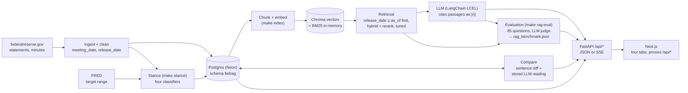

# FedRAG: Technical Report

*A solo project by Hoedong Kim; all eight phases are complete ([status](#-roadmap)). This is the
long version of the README: how each part works, the full results with their caveats, and how to
reproduce them. Deeper method detail lives in [rag-eval.md](rag-eval.md),
[rag-tuning.md](rag-tuning.md), [stance-labeling.md](stance-labeling.md) and [deploy.md](deploy.md).*

FedRAG answers questions about U.S. monetary policy from every policy statement and set of minutes
of the Federal Open Market Committee (FOMC), the Fed's rate-setting committee, since January 2015:
97 meetings, 191 documents, 3,077 indexed passages. It retrieves passages with hybrid keyword and
embedding search plus a reranker, has an LLM answer from those passages alone with a citation for
each claim, and can answer *as of* any past date without looking ahead. Around that core it labels
each statement hawkish (leaning toward tighter policy, higher rates), neutral or dovish (leaning
toward easier policy), explains what changed between two statements, and measures its own
retrieval and answers on a held-out test set.

Why not a general chatbot? Statements change little from one meeting to the next, so the changed
words are the news, and an LLM answering from memory blurs meetings, paraphrases where the wording
is the point and sometimes invents a quote. FedRAG answers only from the documents, or says it can't.

> **Demo mode.** The [public demo](https://fedrag-seven.vercel.app) switches off every OpenAI
> feature: Ask the Fed shows eight answers recorded during the evaluation, and Statement Comparison
> serves the stored analyses of the 96 consecutive pairs. Everything else is complete. To ask your
> own questions, [run it yourself](#-run-it-yourself).

## 📌 Results at a glance

| 🔎 Retrieval | ✍️ Answers | 📈 Policy stance | 🔀 Statement changes |
|:---:|:---:|:---:|:---:|
| **0.357 → 0.579** | **0.413 → 0.553** | **0.84** | **20 of 22** |
| nDCG@10 (0 to 1: how high the right passages rank) of hybrid + rerank on 50 held-out TEST questions, untuned (`phase3`) → tuned retriever | Answer correctness on the same 50, graded by an LLM judge | Accuracy of `gpt-5.4-mini` zero-shot on the 25 statements a human labelled blind | Shift directions called right where the statements' reference labels changed |
| paired +0.222 [+0.158, +0.293] | paired +0.140 [+0.068, +0.218]; wrong refusals 36% → 14% | [0.68, 0.96]; FinBERT, averaged over sentences, scores 0.36, the same as always answering "hawkish" | [0.77, 1.00]; but it also calls a shift on 49 of the 74 pairs whose label stayed the same |

Every number here is read from a tracked results file in [`data/eval/`](../data/eval/):
`rag_benchmark.json` (TEST split, `hybrid_rerank`, `phase3` vs `tuned`), `stance_benchmark.json`
(pre-registered statement rows, human subset) and `compare_benchmark.json` (prompt v3). Intervals
in brackets are 95% percentile bootstraps (10,000 resamples, seed 20261013). The main caveats:
Claude subagents wrote the 85 questions, and most of the retrieval gain is on the 40 TEST questions
that name a month or a day; the answer judge is an LLM (`gpt-5.5`) checked only against Claude
annotators; 72 of the 97 stance reference labels are LLM labels (accuracy on all 97 is 0.897); and
the comparison over-calls shifts, so always answering "unchanged" agrees with the reference more
(0.771 vs 0.469). See [Limitations](#limitations) and each section's **Caveats**.

## 📊 Data

Every document carries a `meeting_date` and a `release_date`, the day it became public, and *as of*
questions filter on the second: minutes come out about three weeks after the meeting, so filtering
on `meeting_date` would hand the model minutes nobody had read yet. The corpus on October 12, 2026:

| | Count | Details |
|---|---|---|
| Meetings | 97 | January 28, 2015 to September 16, 2026: 93 scheduled, 3 unscheduled (October 4, 2019; March 2 and 15, 2020) and 1 notation vote, a decision taken without a meeting, that issued a statement (March 23, 2020) |
| Statements | 97 | One per meeting; 124 to 614 words, median 375 |
| Minutes | 94 | 5,208 to 14,262 words, median about 8,160; the October 4, 2019 and March 2, 2020 meetings are written up in the next minutes, and the March 23, 2020 vote has none |
| Total | 191 documents | 834,616 words in 12,715 paragraphs |

Minutes came out a median of 21 days after the meeting (19 to 24). Release dates are **read from
the Fed, never estimated**: the statement's press release (checked against its URL) and the
"(Released Month DD, YYYY)" note beside each set of minutes. `GET /api/meetings?as_of=2024-10-01`
lists the September 17-18, 2024 meeting with only its statement; its minutes join on October 9.

Four pages were changed after release, and the stored text is today's. The November 7-8, 2018
minutes gained a closing paragraph on October 9, 2026, which `as_of` holds back until that date; a
footnote in the September 21-22, 2021 minutes is served as corrected; and two statements updated one
and four days after release do not say what changed and are served as they read now. Not collected: the Summary of Economic Projections (SEP),
press conference transcripts, implementation notes and PDFs (meetings carry `has_sep` and
`has_press_conference` flags instead).

## 🔎 Retrieval and Grounded Answers

**Chunks and index.** Statements stay whole (97 chunks, median 461 tokens), keeping a decision with
its rationale and vote. Minutes are chunked by section, packing whole paragraphs to 350 tokens
(never past 450, overlapping by at most 60). Each of the 3,077 chunks carries a header such as
`Minutes of the FOMC Meeting, September 17-18, 2024 | Staff Economic Outlook`. `make index` embeds
only new or changed chunks; the first build cost about $0.02.

**Four methods.** `bm25` is keyword search (Okapi BM25; "5.25 percent" also matches "5-1/4
percent"), `dense` is OpenAI-embedding similarity in Chroma, and `hybrid` merges the two rankings
by reciprocal rank fusion (RRF, k = 60). `hybrid_rerank`, the default, rescores the hybrid
candidates with a cross-encoder reranker (`ms-marco-MiniLM-L-6-v2`, a small model that reads the
question and each candidate together).

**Point in time first, then the `tuned` preset.** With `as_of`, every method ranks only chunks
released on or before that date, so a cutoff never leaves fewer than `top_k` passages when enough
exist. (BM25's term-rarity weights still count all chunks, so later documents shape them, though
they are never returned.) The `tuned` preset, the default since the evaluation, then reorders the
eligible chunks: ×3 for a meeting in a month or on a day the question names (×1.25 for a named
year), ×1.5 for statements, and for "how do things stand" questions up to ×2 for recent chunks, the
extra halving every 90 days. It was chosen on DEV questions only; `RETRIEVER_PRESET=phase3` in
`backend/.env` brings back the untuned retriever as first built (`phase3`).

**Grounded answers.** One LangChain chain numbers the top passages `[1]..[n]` with title, section
and release date, and `gpt-5.4-mini` answers in plain text with inline `[n]` markers, which are
then checked and renumbered. With no passage to ground on, the LLM is not called. The prompt
([`backend/app/rag/prompts.py`](../backend/app/rag/prompts.py)) asks for: only the passages; a
citation for every clause, from a passage that supports it; a decline without citations when the
passages don't answer (and what is missing when they answer part); numbers quoted as written
("5-1/4 to 5-1/2 percent"); who holds a view and the minutes' quantifiers ("several") kept;
passages treated as data, not instructions; firsts and dates only when a passage states them; "how
do things stand" answered from the most recent passage, with its date; and, with `as_of`, the view
of someone reading on that date.

The model follows the "most recent passage" rule unevenly, so the code adds a note when the newest
passage an `as_of` answer cites is more than 90 days older than `as_of`. No rule can stop what the
model learned in training; what FedRAG guarantees is that no passage released after `as_of`
reaches the model.

LangChain does the standard parts: text splitters, embeddings, the Chroma store, chat models, its
chain syntax (LCEL) and streaming. BM25 and RRF are custom, because LangChain's `BM25Retriever`
cannot score only the chunks released by `as_of`, and `EnsembleRetriever` cannot pass that filter down.

### Smoke check (n=12, not a benchmark)

Before the evaluation set existed, `make smoke` ran 12 hand-checked questions through all four
methods (hit: an expected document in the top 5; n=11 without the unanswerable one). These are the
untuned (`phase3`) numbers, kept as a record:

| Method | hit@5 | MRR@10 | as_of leaks | median latency |
| --- | ---: | ---: | ---: | ---: |
| `bm25` | 0.82 | 0.74 | 0 | 5 ms |
| `dense` | 0.73 | 0.38 | 0 | 182 ms |
| `hybrid` | 0.64 | 0.62 | 0 | 15 ms |
| `hybrid_rerank` | 0.91 | 0.62 | 0 | 294 ms |

With n=11, one question moves hit@5 by 0.09, so this shows that every method runs and never leaks a
passage from after `as_of`, not which is best. Reading its results turned up the weaknesses the
evaluation then measured: no stemming in BM25 ("cut" against "lower"), no sense of dates or
recency, statements only 97 of 3,077 chunks, a reranker that truncates 42 of the 97 statements (34
lose the whole vote paragraph), stale verdicts under `as_of`, and attribution slips.

## 💬 Ask the Fed


*The banking question as of April 30, 2023, answered while the page was built, replayed on a production build.*

`/ask` takes a question, an optional *as of* date and, under **Search settings**, the method and the
number of passages (3 to 10). The answer streams in as it is written; each `[n]` marker previews and
links to its numbered source, and Stop cancels. API reference: [live `/docs`](https://fedrag-api.vercel.app/docs).

**On the public demo** the ask endpoints are off (they answer `403`). Instead the page shows eight
real TEST answers recorded with the production setup (`tuned`, hybrid + rerank, top 5,
`gpt-5.4-mini`), with their citations and the judge's verdicts, from `data/eval/ask_examples.json`.
They were picked to cover the question types, not at random: six of the seven answerable ones state
every required fact, against a TEST average correctness of 0.553.

## 📏 RAG Evaluation

On 50 answerable held-out TEST questions, the retriever tuned on DEV beats the untuned `phase3` one
for all four methods, and the answers built on it state more required facts, decline less and stay
faithful; the default switched under a rule fixed before the single TEST run. Still weak:
multi-document and point-in-time questions (nDCG@10 0.33 and 0.29), 14% of answerable questions
still declined, and most of the gain depends on the question naming a month or a day.


### The question set

`data/eval/rag_questions.jsonl` holds 85 questions, **30 DEV and 55 TEST**: 76 answerable, 8
unanswerable and 1 point-in-time question with nothing released by its date. 18 carry an *as of*.

| Type | What it tests | DEV | TEST |
|---|---|---:|---:|
| `statement_fact` | Decisions, votes, dissents and balance-sheet actions in one statement | 5 | 9 |
| `minutes_fact` | Staff outlook and participants' views, with their quantifiers ("several", "a few") | 6 | 12 |
| `point_in_time` | An `as_of` date where the right answer depends on what was public then | 5 | 10 |
| `date_specific` | A named meeting on a topic that recurs in nearly the same words | 4 | 6 |
| `multi_doc` | Comparisons, sequences, firsts and counts across meetings | 4 | 7 |
| `paraphrase` | Everyday or market wording ("QT", "bps", "hike") for the Fed's terms | 3 | 6 |
| `unanswerable` | Before 2015, SEP projections, press conferences, other central banks, the future | 3 | 5 |

Three Claude subagents drafted 87 candidates from `data/index/chunks.jsonl` alone, without access to
the retrievers or the API, and a fourth checked each against the corpus; 14 were dropped and the 12
smoke questions joined DEV. Each answerable question has gold chunks, the passages that answer it
(primary ones state a required fact, supporting ones back it up), 1 to 4 required facts and a
reference answer; per type, 35% went to DEV by a seeded shuffle, made once. The owner reviewed 20
TEST items and found 6 requiring facts their question does not ask for, so before TEST was scored a
rule was applied to all 85: a required fact must answer something the question asks. 33 items
changed ([rag-eval.md](rag-eval.md)).

### Tuning on DEV, one run on TEST

143 retriever configurations were scored on the 26 answerable DEV questions, and the simplest within
0.01 of the best hybrid + rerank nDCG@10 was frozen as `tuned` on 2026-10-13. The date, statement
and recency priors made it in; stemming, query expansion, RRF weights and a stronger reranker did
not help on DEV, and scoring long passages in windows was not tried ([rag-tuning.md](rag-tuning.md)).
Its DEV nDCG@10 of 0.638 (against 0.322 for `phase3`) is optimistic by construction.

The switch rule: make `tuned` the default only if, on TEST, (a) the paired-bootstrap 95% CI of
hybrid + rerank nDCG@10, `tuned` minus `phase3`, lies entirely above 0, and (b) answer correctness
is not worse (paired CI lower bound above −0.05). The project recorded the rule itself before the
run; no timestamped copy predates it. Both held, (a) at +0.222 [+0.158, +0.293] and (b) at +0.140
[+0.068, +0.218], so `tuned` became the default. The gain shrank from +0.317 on DEV to +0.222 on
TEST, consistent with selection bias, though the gap is within noise.

### TEST results: retrieval

The 50 answerable TEST questions, each `as_of` applied before ranking, with bootstrap intervals over
questions. Recall@5 is the share of a question's gold chunks in the top 5; MRR@10, the reciprocal
rank of the first gold chunk; nDCG@10 scores the ranking with gain 2 for a primary chunk and 1 for a
supporting one; doc recall@5 is the share of the relevant documents in the top 5. Δ is the paired
change from `phase3` ([definitions](rag-eval.md#how-phase-7-scores-the-set)). Metrics are
tie-aware, latency leaves out the query embedding, and no run leaked a passage.

| Config | Method | Recall@5 | MRR@10 | nDCG@10 | Δ nDCG@10 | Doc recall@5 | p50 / p95 ms |
|---|---|---:|---:|---:|---:|---:|---:|
| `phase3` | BM25 | 0.193 [0.11, 0.29] | 0.310 [0.20, 0.43] | 0.217 [0.14, 0.30] | | 0.425 [0.32, 0.54] | 7 / 11 |
| `phase3` | Dense | 0.242 [0.17, 0.32] | 0.472 [0.36, 0.59] | 0.296 [0.23, 0.37] | | 0.512 [0.41, 0.62] | 3 / 11 |
| `phase3` | Hybrid | 0.264 [0.18, 0.36] | 0.495 [0.38, 0.61] | 0.322 [0.24, 0.41] | | 0.529 [0.43, 0.63] | 13 / 17 |
| `phase3` | Hybrid + rerank | 0.297 [0.21, 0.39] | 0.502 [0.39, 0.62] | 0.357 [0.27, 0.44] | | 0.530 [0.43, 0.63] | 277 / 293 |
| `tuned` | BM25 | 0.334 [0.24, 0.43] | 0.572 [0.45, 0.69] | 0.423 [0.33, 0.52] | +0.206 [+0.149, +0.270] | 0.620 [0.53, 0.71] | 7 / 10 |
| `tuned` | Dense | 0.436 [0.35, 0.53] | 0.767 [0.66, 0.87] | 0.524 [0.44, 0.61] | +0.228 [+0.172, +0.289] | 0.692 [0.60, 0.78] | 5 / 12 |
| `tuned` | Hybrid | 0.424 [0.34, 0.52] | 0.694 [0.58, 0.80] | 0.520 [0.43, 0.61] | +0.198 [+0.147, +0.252] | 0.660 [0.57, 0.75] | 13 / 19 |
| **`tuned`** | **Hybrid + rerank** (default) | **0.491** [0.39, 0.59] | 0.674 [0.57, 0.78] | **0.579** [0.49, 0.67] | **+0.222** [+0.158, +0.293] | 0.692 [0.60, 0.78] | 275 / 289 |

Every paired interval excludes zero. Under `phase3`, hybrid + rerank beats BM25 by +0.140 [+0.083,
+0.197]. The reranker's own step over hybrid is +0.034 [−0.023, +0.088] under `phase3`, an interval
that includes zero, and +0.059 [+0.003, +0.116] under `tuned`, barely resolved.

### TEST results: answers

Each run's top 5 passages go through the production chain (`gpt-5.4-mini`), and `gpt-5.5` checks
every claim, citation and required fact with strict structured output. Correctness is the share of
required facts the answer states; faithfulness, the share of claims its cited passages support
(answers that make claims only, n in the cell); citation accuracy, the share of citations that
support their text fully or in part (fully only, in the next column). Refusal accuracy is the share
of the 5 unanswerable questions declined without invented facts; false refusals, the share of
answerable ones declined; a partial answer answers part and says what is missing.

| Run | Faithfulness | Citation acc. | Citation acc., full support only | Correctness | Refusal acc. | False refusals | Answers / partial / declines |
|---|---:|---:|---:|---:|---:|---:|---:|
| `phase3` BM25 | 0.889 [0.81, 0.95], n = 45 | 0.978 [0.93, 1.00] | 0.743 [0.62, 0.86] | 0.228 [0.14, 0.32] | 1.00 (5/5) | 0.56 [0.42, 0.70] | 12 / 10 / 33 |
| `phase3` Hybrid + rerank | 0.883 [0.81, 0.94], n = 47 | 0.943 [0.89, 0.99] | 0.720 [0.63, 0.81] | 0.413 [0.31, 0.53] | 1.00 (5/5) | 0.36 [0.24, 0.50] | 23 / 9 / 23 |
| **`tuned` Hybrid + rerank** | **0.937** [0.89, 0.98], n = 52 | **0.982** [0.95, 1.00] | **0.808** [0.73, 0.88] | **0.553** [0.45, 0.65] | 0.80 (4/5)\* | **0.14** [0.06, 0.24] | 33 / 10 / 12 |
| Paired Δ, `tuned` − `phase3` hybrid + rerank | +0.074 [+0.005, +0.154], n = 46 | +0.040 [−0.016, +0.105] | | +0.140 [+0.068, +0.218] | −0.20 [−0.60, 0.00] | −0.22 [−0.34, −0.12] | |

The citation-accuracy change has an interval that includes zero, and the refusal change is the
judge error marked \*. BM25 answers are about as faithful but decline 56% of the answerable
questions (28 of 50), so their correctness is much lower. Four verdicts on `tuned` look wrong:

- **\* `ua-03`:** a correct decline failed over an uncited remark; fixed, refusal accuracy is 5/5.
- **`pp-03`:** the answer is about the wrong meeting, yet gets 0.5 for correctness instead of 0.
- **`sf-05`:** both citations of a sentence marked as not supporting it, though together they do.
- **`pp-01`:** exactly the caps asked for, but 0/3: its required facts bundle in the step schedule.

Fixing `ua-03` raises `tuned` faithfulness to 0.956 (n = 51); correcting `pp-03` lowers the
correctness gain by 0.01; relabelling `pp-01` (under review) would raise it by up to about 0.02.
None changes the switch, and the metrics keep the judge's verdicts. The judge repeated the `ua-03`
error on 4 BM25 answers (without them BM25 faithfulness is 0.942, n = 43), and `phase3` hybrid +
rerank answers have the same error (`sf-05` and `mf-08` in the judge check), so the paired
difference is left as judged. All known judge errors are listed in
[rag-eval.md](rag-eval.md#known-judge-errors).

### By question type

TEST, hybrid + rerank, `phase3` → `tuned`, with 6 to 12 questions per type. Correctness and
false-refusal levels are point estimates; the correctness change carries its paired interval.

| Type | n | nDCG@10 | Correctness, paired change | False refusals |
|---|---:|---:|---:|---:|
| `date_specific` | 6 | 0.50 [0.28, 0.73] → 0.86 [0.74, 0.96] | 0.62 → 0.86, +0.24 [+0.04, +0.46] | 0.33 → 0.00 |
| `statement_fact` | 9 | 0.39 [0.23, 0.54] → 0.75 [0.67, 0.84] | 0.59 → 0.69, +0.10 [+0.03, +0.20] | 0.22 → 0.11 |
| `minutes_fact` | 12 | 0.52 [0.32, 0.71] → 0.80 [0.67, 0.93] | 0.43 → 0.61, +0.18 [−0.03, +0.43] | 0.25 → 0.08 |
| `paraphrase` | 6 | 0.27 [0.12, 0.41] → 0.36 [0.17, 0.54] | 0.44 → 0.53, +0.08 [−0.11, +0.31] | 0.33 → 0.00 |
| `multi_doc` | 7 | 0.22 [0.07, 0.40] → 0.33 [0.12, 0.54] | 0.19 → 0.33, +0.14 [+0.04, +0.29] | 0.57 → 0.29 |
| `point_in_time` | 10 | 0.19 [0.06, 0.35] → 0.29 [0.15, 0.43] | 0.24 → 0.34, +0.10 [0.00, +0.23] | 0.50 → 0.30 |
| `unanswerable` | 5 | no gold | refusal 1.00 → 0.80 (the `ua-03` judge error) | |

The correctness interval excludes zero for `date_specific`, `statement_fact` and `multi_doc`; the
`point_in_time` interval reaches zero (3 of 10 improved, none got worse), and `minutes_fact` and
`paraphrase` are within noise. The date prior finds the named meeting among near-identical
neighbours, and the statement boost lifts the chunk with the vote. Nothing gathers several
documents for a span of meetings, so `multi_doc` stays weakest (`md-05` and `md-08` score nDCG@10
0 under both configs).

### Checking the judge

The judge was checked on a blind sample of 40 TEST answers (383 verdicts), all `phase3` hybrid +
rerank, so it says nothing direct about `tuned` or BM25 answers. **All three annotators are Claude
Opus 5.5 sessions, not people.** C worked in isolation from a copy of the sample and is the main
check. A and B agreed on all 383 slots but shared a directory, so they are not independent.

| Check | n | Judge vs C | κ | Judge vs A (= B) | κ | C vs A | κ |
|---|---:|---:|---:|---:|---:|---:|---:|
| Claim supported | 155 | 0.935 | 0.63 | 0.942 | 0.68 | 0.981 | 0.89 |
| Citation supports its text | 73 | 0.945 | 0.64 | 0.932 | 0.58 | 0.986 | 0.93 |
| Required fact stated | 115 | 0.983 | 0.96 | 0.974 | 0.94 | 0.991 | 0.98 |
| Answer declines | 40 | 0.950 | 0.90 | 0.925 | 0.85 | 0.975 | 0.95 |

Each cell is the share of pass/fail verdicts in agreement, with Cohen's κ. The judge and C differ on
18 verdicts; Claude read the clearest against the passages and found the annotators more often
right ([details](rag-eval.md#judge-validation)). The judge lets holder and quantifier slips
through, marks an answer's comments on its own passages ("the closest related passage is...") as
unsupported, and is slightly strict on required facts. On this sample the faithfulness errors
roughly cancel, and correctness, the metric in the switch rule, agrees best. The judge passes more
citations than C (0.93 vs 0.90) but gives full support to fewer (0.71 vs 0.79), so read the answer
table's two citation columns as a lenient and a strict estimate.

### Limitations

- **LLM-built questions.** Claude subagents wrote the questions and gold, and a person reviewed only
  20 of 85. Gold can miss a passage that says the same thing.
- **Small n.** With 50 answerable TEST questions, one question moves a mean by about 0.02; per-type
  cells rest on 6 to 12. Questions on the same meeting are not independent, so real intervals are wider.
- **An LLM judge**, checked only against Claude annotators on 40 `phase3` answers, and from the same
  vendor as the generator. Each answer was generated once.
- **Date-heavy questions.** 40 of the 50 name a month or a day, and the date prior is most of the
  gain. Split post hoc, the nDCG@10 gain is +0.255 [+0.178, +0.337] on those, +0.188 [+0.121,
  +0.243] on the 5 naming only a year, and −0.006 [−0.018, 0.000] on the 5 naming no time at all.
  On such questions expect little or no gain.
- **Not measured:** answers for dense or hybrid, look-ahead from the model's own knowledge (only
  retrieval leakage, which was 0), and latency beyond one laptop answering one question at a time.

### What it cost

| Stage | Model | Calls | Input / output tokens | Cost |
|---|---|---:|---:|---:|
| Answers (TEST: `phase3` BM25 and hybrid + rerank, `tuned` hybrid + rerank) | `gpt-5.4-mini-2026-03-17` | 165 | 413k / 33k | $0.45 |
| Judge (all three runs, 165 answers) | `gpt-5.5`, reasoning low | 164 | 375k / 90k | $4.53 |
| Query embeddings (85 questions) | `text-embedding-3-small` | 85 texts | 2k / 0 | $0.00004 |
| **Total** | | | | **$4.98** of a $5.00 budget |

Estimates from token counts and the prices in code, not invoiced amounts (per M input / output
tokens: `gpt-5.5` $5 / $30, from OpenAI's pricing page; `gpt-5.4-mini` $0.75 / $4.50, from
third-party lists, not verified). On TEST, `tuned` answers took a median of 2.1 s (p95 4.0 s) and
about $0.0027 each; `phase3` hybrid + rerank 2.1 / 3.5 s and $0.0029, BM25 1.6 / 3.3 s and
$0.0026. In production an answer costs about $0.003, and judging one about $0.03.

## 📈 Policy Stance


*`/stance` with all four classifiers on, above the reference labels and the FRED target range.*

`/stance` scores each of the 97 statements from −1 (most dovish) to +1 (most hawkish) with four
classifiers. Two average over a statement's non-procedural sentences: `keyword`, with term lists
learned from Trillion Dollar Words (TDW), and `finbert`, `ProsusAI/finbert` fine-tuned on TDW (three
seeds); above +0.15 is hawkish and below −0.15 dovish. Two read the whole statement: `gpt-5.4-mini`
zero-shot, with the labelling rubric as its task definition, and few-shot, with 12 TDW examples. No
score or confidence is calibrated.

**Two benchmarks.** TDW ([Shah, Paturi and Chava, ACL 2023](https://aclanthology.org/2023.acl-long.368/))
is hand-labelled FOMC sentences from 1996-2022 with three train/test splits; the table's first
column is each classifier's macro-F1 there (mean ± sd over the seeds), against 0.217 for always
predicting neutral. The other columns score whole statements against reference labels.

**Reference labels.** Two LLM annotators labelled all 97 statements under the rubric in
[stance-labeling.md](stance-labeling.md) and an LLM adjudicator checked them (all Claude Opus 5.5
subagents); they agreed on all 97, which shows a consistent rubric, not right labels. The owner
re-labelled 25 blind and agreed on 23 (Cohen's κ 0.88). The reference is the human label where
there is one, otherwise the LLM label (37 hawkish, 35 neutral, 25 dovish). The four classifier rows
are pre-registered: the aggregation and its ±0.15 thresholds were fixed in code before the
reference labels were made, though no timestamped registration exists. The other rows are post hoc
or use no classifier.

| Statements | TDW sentences, macro-F1 | Calls: dovish / neutral / hawkish | Accuracy, all 97 [95% CI] | Macro-F1 | Accuracy, 25 human-labelled [95% CI] |
|---|---:|---:|---:|---:|---:|
| `keyword` | 0.482 ± 0.041 | 12 / 63 / 22 | 0.629 [0.536, 0.722] | 0.619 | 0.560 [0.360, 0.760] |
| `finbert` | 0.600 ± 0.012 | 5 / 85 / 7 | 0.433 [0.330, 0.526] | 0.355 | 0.360 [0.160, 0.560] |
| `llm_zero_shot` | 0.674 ± 0.007 | 28 / 25 / 44 | 0.897 [0.835, 0.948] | 0.897 | 0.840 [0.680, 0.960] |
| `llm_few_shot` | 0.682 ± 0.026 | 30 / 22 / 45 | 0.845 [0.773, 0.918] | 0.845 | 0.760 [0.600, 0.920] |
| `finbert`, **post hoc**: decision sentence first | | 12 / 62 / 23 | 0.691 [0.598, 0.784] | 0.676 | 0.760 [0.600, 0.920] |
| Rate-move rule, **post hoc**, no classifier | | 11 / 65 / 21 | 0.691 [0.598, 0.784] | 0.678 | 0.760 [0.600, 0.920] |
| Always hawkish, no classifier | | 0 / 0 / 97 | 0.381 [0.289, 0.485] | 0.184 | 0.360 [0.200, 0.560] |

Sentence skill does not carry over to statements. FinBERT reaches 0.600 on TDW sentences but calls
85 of 97 statements neutral, because averaged over mostly descriptive sentences its score stays
inside ±0.15, and its accuracy is within noise of always answering "hawkish" (paired +0.052
[−0.124, +0.216]). Letting the decision sentence decide (post hoc) lifts it to 0.691, but a rule
reading only the decision verb scores the same and makes the same call on 94 of 97, so that is not
FinBERT skill. Few-shot trails zero-shot within noise (+0.052 [−0.031, +0.134]), and all 10
zero-shot misses are reference-neutral statements.

**Caveats.** The LLM classifiers are prompted with the rubric the reference annotators followed,
and those annotators were LLMs too (another model family, which limits but does not remove the
effect), so part of the 0.897 is by construction. The 25 human labels are the stricter test, but
they are few, over-represent hard cases, and the reviewer saw each statement's redline against the
previous one, which the rubric excludes. Consecutive statements are near-duplicates, so the intervals
are too narrow; whole-year resampling widens them by about a fifth to a half. TDW labels sentences by
the economy they describe, not the policy path, and the model may have seen TDW and 92 of the 97
statements (before its 2026-03-17 snapshot) in training.

**Cost.** Building it took 332 OpenAI calls, about $0.95 with 8 prompt-writing calls. A first run of
`make stance-benchmark` and `make stance` costs about $0.92, and cached predictions make reruns free.

## 🔀 Statement Comparison


*`/compare` for July 31 → September 18, 2024: the stored analysis, which sits above the sentence diff.*

**The diff** uses no LLM. Sentences are aligned in order by global sequence alignment
(Needleman-Wunsch) over word-token similarity (the `difflib` ratio), never pairing two below 0.5, a
threshold fixed before any real statement was diffed. Pairs are unchanged or modified (with a
word-level diff), and lone sentences added or removed. Lexical similarity is deliberate: the news
is in a few changed words ("moderated" → "slowed"), and token overlap shows them, costs nothing and
never varies. Over the 96 consecutive pairs: 911 unchanged, 434 modified, 239 removed, 226 added.

**The analysis** is one strict structured-output call to `gpt-5.4-mini` per pair. It sees only the
changed items (with ids) and the target statement, and returns a summary, up to six key changes
(ids, quoted words, a direction) and a `stance_shift`: more_hawkish, unchanged or more_dovish. It
is told to read as of the target's release, follow the policy path rather than descriptions of the
economy, and compare decisions as decisions (a hike after a hike, with guidance as before, is
unchanged; a hike after a hold is a shift). Code drops citations of changes that are not in the
diff and unquotes inexact quotes. Analyses are cached per pair in Neon; opening a page never calls
OpenAI. The served v3 prompt came after v2 was scored.

**Results.** With no human shift labels, each stored `stance_shift` of the 96 consecutive pairs is
compared with the shift implied by the reference stance labels (74 unchanged, 11 more_hawkish, 11
more_dovish), with 95% bootstrap intervals over pairs (`compare_benchmark.json`):

| Shift calls | Calls: dovish / unchanged / hawkish | All 96 pairs | Label changed (22) | Label same (74) | Both labels human (10) |
|---|---:|---:|---:|---:|---:|
| LLM, prompt v2 (pre-registered) | 32 / 26 / 38 | 0.479 [0.375, 0.573] | 0.955 [0.864, 1.000] | 0.338 [0.230, 0.446] | 0.600 [0.300, 0.900] |
| LLM, prompt v3 (**post hoc**, served) | 36 / 27 / 33 | 0.469 [0.365, 0.573] | 0.909 [0.773, 1.000] | 0.338 [0.230, 0.446] | 0.600 [0.300, 0.900] |
| Always "unchanged" (no model) | 0 / 96 / 0 | 0.771 [0.688, 0.854] | 0.000 | 1.000 | 0.500 [0.200, 0.800] |
| Rate-decision rule (no model, **post hoc**) | 15 / 66 / 15 | 0.750 [0.656, 0.833] | 0.636 [0.409, 0.818] | 0.784 [0.689, 0.878] | 0.700 [0.400, 1.000] |
| `llm_zero_shot` score delta, ±0.2 (shares the reference rubric: an upper bound) | 19 / 58 / 19 | 0.792 [0.708, 0.865] | 0.909 [0.773, 1.000] | 0.757 [0.662, 0.851] | 0.900 [0.700, 1.000] |

When the labels move, v3 gets 20 of 22 directions right and none points the opposite way, but the
difference of the `llm_zero_shot` stance scores also gets 20, so on these pairs the comparison does
no better than that. The output stays tied to the diff: all 665 cited change ids are valid and 931
of 948 quotes are verbatim.

**Caveats.** The comparison over-calls shifts: it calls one on 49 of the 74 same-label pairs, so
over all 96 it agrees 0.469, below always answering "unchanged" (0.771). Of those 74 pairs, 16
change the rate decision (the prompt says to call those a shift, and v3 does), 2 are the pairs into
and out of the March 23, 2020 statement, which states no rate decision (v3 calls both a shift), and
56 change neither. On those 56, v3 still calls 31 shifts (the score delta 10), in the analyses read
often from changed descriptions of the economy. 23 of 96 calls changed between v2 and v3, 6 to the
opposite direction. The intervals treat the pairs as independent, though each statement is the
target of one pair and the base of the next; resampling whole years widens v3's all-pairs interval
to [0.327, 0.602]. Confidence is uncalibrated (0.92 on hits and misses alike), only 10 pairs have
human labels on both statements, and a key change's direction can contradict its own reasoning, so
the diff rows are authoritative.

**Cost.** Building it took 210 OpenAI calls, about $0.93, covering prompt validation and both the
v2 and v3 runs; `make compare-precompute` alone is about $0.44 for the 96 pairs.

## 🏗 Architecture



The browser only talks to Next.js, which proxies `/api/*` to FastAPI. The Pydantic schemas are the
contract: CI regenerates the OpenAPI file and the TypeScript types from them and fails on any drift.

<a id="-quickstart"></a>

## 🚀 Run it yourself

**Prerequisites:** macOS or Linux (on Windows, use WSL), Python 3.11+, Node.js 20.19+ or 22.12+
with npm, and `make`. Docker is optional (a local Postgres, and the database tests).

```bash
make setup                             # backend/.venv + backend deps, frontend npm install
cp backend/.env.example backend/.env   # every setting in it is optional
make dev                               # backend on :8000 + frontend on :3000; Ctrl-C stops both
```

Open **http://127.0.0.1:3000**; the interactive API docs are at **http://127.0.0.1:8000/docs**
([live](https://fedrag-api.vercel.app/docs)). What works next depends on what you add:

| You add | Cost | What works |
|---|---|---|
| Nothing (a fresh clone) | free | RAG Performance, from the tracked results, with the passage text (`data/index/chunks.jsonl` is tracked); the eight recorded answers, which Ask the Fed shows under `PUBLIC_DEMO=true make dev`, as the public demo does |
| A database: `make ingest`, then `make db-up` (Docker) or a Neon URL as `DATABASE_URL`, then `make db-load` | free | Meetings, and Statement Comparison's diff of any two statements |
| The stance pipeline: `make stance-fetch`, `make stance-train`, `make stance STANCE_ARGS='--classifiers keyword finbert'` | free | Policy Stance with the two classifiers that need no OpenAI key (switch the chart to them: it opens on LLM few-shot). `make stance` also rescores `data/eval/stance_benchmark.json` from your run; `git restore` it to keep the published results |
| An OpenAI key in `backend/.env`, then `make index` | about $0.02 once, then about $0.003 an answer | Everything: Ask the Fed streams new answers; `make stance` adds the LLM classifiers (about $0.92 the first time, with `make stance-benchmark`); `make compare-precompute` stores the analyses of the 96 consecutive pairs (about $0.44) and **Generate analysis** writes one for any pair |

The rows build on each other: `make index`, `make stance` and `make compare-precompute` need the
documents from `make ingest`, and a database to read from or load into (`make index
INDEX_ARGS="--source processed"` works without one).

```bash
make ask Q='How did the FOMC assess the banking system after the March 2023 bank failures?' AS_OF=2023-04-30
make rag-eval-report        # rebuild from data/eval_cache (git-ignored: needs your own earlier rag-eval)
make rag-eval MAX_USD=6.5   # retrieval, hybrid + rerank TEST answers, judge (from scratch ~$6.40)
make stance-benchmark       # TDW sentence benchmark (cached LLM calls; refuses an estimate over $1)
make compare-evaluate       # score the stored analyses -> compare_benchmark.json, no LLM calls
make check                  # what CI checks, minus the Postgres tests; no OpenAI key needed
```

On a fresh clone `make rag-eval-report` stops without writing. `make rag-eval` answers and judges
hybrid + rerank only; the `phase3` BM25 rows come from the same `answers` and `judge` steps of
`python -m app.evaluation` with `--split test --config phase3 --methods bm25`. Every command that calls OpenAI prints a cost estimate, refuses to start above its
budget and caches its results; `make help` lists every target. With pyenv and no Python 3.13,
`.python-version` (meant for Vercel) breaks `python3` in the repository: run `pyenv install 3.13`,
or `PYENV_VERSION=<a version you have> make setup`.

## 🚢 Deploy

The public demo runs on free tiers as two Vercel projects from this repository: the Next.js frontend
and the FastAPI backend as one Python function (no vector store, model weights or secrets) that
reads Neon through a role limited to `SELECT` on schema `fedrag`. It costs $0: the API holds no
OpenAI key, and `PUBLIC_DEMO=true` switches off every path that would use one. The step-by-step
guide, with the Hugging Face Space alternative, is [docs/deploy.md](deploy.md).

## 🗺 Roadmap

The project ran in eight phases, all complete: 1 environment setup, 2 FOMC data collection, 3 RAG
pipeline (the `phase3` retriever), 4 Ask the Fed, 5 Policy Stance, 6 Statement Comparison, 7 RAG
evaluation and 8 deployment. Not planned yet, but the evaluation points at them: gathering several
documents for questions that span meetings, scoring long passages in windows, press conferences
and the SEP, and tracing with LangSmith.

## 🛠 Tech Stack

| Area | Tools |
|---|---|
| **Backend and data** | Python 3.11+, FastAPI, Pydantic v2, httpx2, Beautiful Soup with lxml, Neon Postgres with psycopg 3 |
| **LLM and retrieval** | LangChain (LCEL, langchain-openai); OpenAI `gpt-5.4-mini`, `text-embedding-3-small` and `gpt-5.5` as judge; Chroma, rank-bm25, a sentence-transformers cross-encoder |
| **Stance, comparison, evaluation** | FinBERT fine-tuned with Hugging Face Transformers on PyTorch, scikit-learn, `difflib`, NumPy |
| **Frontend, deployment and tooling** | Next.js 16, React 19, TypeScript, Tailwind CSS v4, Recharts; Vercel, Docker (alternative host); pytest, Ruff, ESLint, Vitest, openapi-typescript, GitHub Actions |

## License

[MIT](../LICENSE), for this repository's code only. Third-party data and models keep their own terms:

- **Trillion Dollar Words** (Agam Shah, Suvan Paturi and Sudheer Chava, ACL 2023;
  [paper](https://aclanthology.org/2023.acl-long.368/), [repository](https://github.com/gtfintechlab/fomc-hawkish-dovish)
  at commit `9864698`): CC BY-NC 4.0. Downloaded on demand into `data/external/`, never redistributed.
- **ProsusAI/finbert**: [CC BY-NC-SA 4.0](https://huggingface.co/ProsusAI/finbert). The models
  that `make stance-train` fine-tunes from it are therefore non-commercial and ShareAlike, not MIT,
  and are not redistributed (`data/models/` is git-ignored).
- **FOMC statements and minutes** from federalreserve.gov are works of the US government.
- **Federal funds target range:** Board of Governors of the Federal Reserve System,
  DFEDTARL/DFEDTARU, via FRED (Federal Reserve Bank of St. Louis).
- **`cross-encoder/ms-marco-MiniLM-L-6-v2`**, the reranker: Apache 2.0 per its
  [model card](https://huggingface.co/cross-encoder/ms-marco-MiniLM-L-6-v2). Downloaded from
  Hugging Face at run time, never redistributed, and not loaded at all by the public demo.
- **What the public demo redistributes.** The deployed API (the Vercel function, or the Hugging
  Face Space bundle) holds this repository's code and tracked results, which include
  `data/index/chunks.jsonl`, passages of the FOMC documents above. It holds no file or label from
  the Trillion Dollar Words dataset (its sentences come from FOMC documents, so FOMC passages
  naturally contain some of them), no FinBERT or reranker weight and no OpenAI key.
- **Generated text.** The answers, analyses, labels and judge verdicts in `data/eval/` were written
  by OpenAI models (`gpt-5.4-mini`, `gpt-5.5`) or Anthropic Claude subagents, as each section says.
